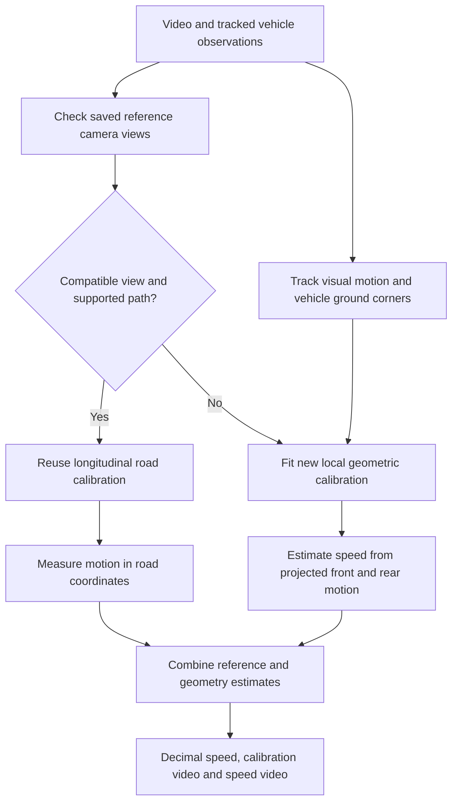

# Calibration methods and the selected workflow

The [research report](output/calibration_comparison/README.md) compares 18 calibration/model versions and 20 reference/geometry fusion configurations on the 30 supplied Mercedes clips. Every video has its own test result. Its speed is excluded from reference calibration and automated configuration selection for that test.

These are development experiments on previously inspected clips. The selected reference-assisted method can use other labelled passes of the same car. It still has errors above the requested ±2 km/h tolerance.

## Selected method

The selected development configuration combines **75% reference-library speed and 25% geometric speed**, using an overlap-weighted average of up to three matching references when a suitable reference view exists. It uses the geometric estimate alone when the library has no supported match.



The reference library estimates a local longitudinal distance coordinate from a known-speed pass and checked optical flow. Image features identify compatible views. The query video is excluded from its own reference library.

The geometric component fits the front and rear vehicle corners to projective motion curves. The rear should pass the front's position after a delay related to vehicle length divided by speed. Both longitudinal sides share a motion vanishing point estimated from optical flow. The assumed length is 4.9 m; a single metric correction comes from the designated calibration passes. Those passes are excluded when one of them is the test.

The camera lookup reuses saved road calibration. Vehicle motion is still measured in every new clip. When no reference view matches, calibration is fitted from that video's geometry and motion. The selected method estimates distances along the observed path; whole-road width and absolute orientation remain unmeasured.

## Methods compared

| Family / versions | Implementation and evidence |
|---|---|
| Projective time delay: `v2`, `v2b` | Fit front/rear motion as 1D or 2D rational curves. The 2D version was more consistent across camera views. |
| Shared vanishing points: `v2c`, `v2d`, `v7` | Fit the two vehicle sides separately while sharing their motion direction and front/rear delay. Optical-flow constraints improve the camera-motion direction estimate. |
| Rigid 3D bundle: `v3`, `v3b`, `v7b` | Fit one camera and constant 3D translation to many cuboid observations. Variants estimate radial distortion or constrain the translation axis using visual motion. |
| Fitted effective length: `v7c` | Relax the inferred cuboid length while retaining width/height priors. Large variation in inferred length exposed instability; this version was not selected. |
| Learned calibration: `v4`, `v4b` | Run the released NAVER transformer on segmentation-mask moments and motion directions. Compare a direct context with an ensemble. A good pilot fit did not transfer consistently. |
| Learned calibration and optical flow: `v5`–`v5d` | Transport a ground-contact anchor with forward/backward checked feature flow and robust affine fitting. Compare adaptive frame spacing and constant-motion map refinement. |
| Silhouette fitting: `v6` | Fit a generic cuboid or sedan envelope to image boxes. Small image residuals could still accompany incorrect focal length and speed. |
| Motion-based lens calibration: `v9` | Estimate a division-model radial coefficient and motion vanishing point from visual correspondences. Reject boundary/ill-conditioned fits before temporal calibration. |
| Reference-library fusion | Compare the strongest match, a median, and averages of the top three matches, with reference weights 0, 0.25, 0.5, 0.75 and 1. |

All versions preserve their estimates, including failures. [Raw metrics](output/calibration_comparison/raw_metrics.json) show performance before reference scale correction. The main version table reports pilot metric corrections explicitly. The final hybrid also benefits from additional reference passes; its improvement cannot be attributed solely to automatic geometry.

## Research sources and adaptations

- [Revaud and Humenberger, ICCV 2021](https://github.com/naver/cctv): the released learned calibration network was actually run. The adapter downloads upstream code at revision `80b8bc4964eddfda32c40e6d1c8fe8b62f777f55`. The checkpoint SHA-256 is `bcb5af76b769788ec18b663e0e1a879ab2d3dce30eb2d0f3162e9730e5204fbf`. Upstream CC BY-NC-SA 3.0 terms and notices are retained in runtime storage; weights are excluded from Git.
- [Kocur and Ftáčnik, 2021](https://arxiv.org/abs/2103.11438): vehicle vanishing points informed the geometric experiments. This project uses its own optical-flow and motion-line estimator; it did not run the authors' DeepVP checkpoint.
- [Su et al., 2026](https://arxiv.org/abs/2608.16785): dynamic vehicle-template calibration and warped optical flow motivated the hybrid experiments. This project uses the existing cuboid model and contact-anchor tracking. It does not reproduce the paper's 36-keypoint detector.
- [Fitzgibbon, 2001](https://www.robots.ox.ac.uk/~vgg/publications/2001/Fitzgibbon01b/fitzgibbon01b.pdf): the division lens model informed radial correction. This project's nonlinear motion fit differs from the paper's two-view eigenvalue method.
- [Vuong et al., WACV 2024](https://github.com/kvuong2711/OpenTrafficCam3D): scene reconstruction is a useful alternative when street-level/GPS imagery exists. Those inputs were unavailable for this experiment, so this method was not run.
- [Sochor et al., 2017](https://arxiv.org/abs/1702.06451): known vehicle geometry remains the scale motivation for the original prototype and the temporal candidates. No vehicle-specific CAD model was fitted here.

No network weights were fine-tuned. These experiments change calibration, motion measurement, scale fitting and model selection.

## Reproduce

The private [GPU comparison notebook](https://www.kaggle.com/code/hayyanfaisal/fyp-per-video-calibration-method-comparison) produces speed-blind first-round model outputs. The private [CPU refinement/report notebook](https://www.kaggle.com/code/hayyanfaisal/fyp-calibration-refinement-report) runs the next versions, individual tests and all 60 videos.

From this feature folder, recalculate the report from the committed inputs:

```powershell
New-Item -ItemType Directory -Force outputs/comparison_reproduction | Out-Null
Copy-Item -LiteralPath output/calibration_comparison/scene_registrations.json -Destination outputs/comparison_reproduction/scene_registrations.json
python calibration_comparison.py --inference-dir output/mercedes_validation/inference --first-round output/calibration_comparison/inputs/round1 --second-round output/calibration_comparison/inputs/round2 --output outputs/comparison_reproduction --no-render
```

To regenerate videos, omit `--no-render` and add `--video-dir 'C:\Users\hayya\Videos\FYP\Speed\MercedesAMG550'`. FFmpeg is required. Rebuilding inference uses `research_inference.py` and requires a matching PyTorch/TorchVision installation and GPU; saved CPU calculations need the normal local requirements.

Run `python -m unittest test_calibration_candidates -v` for known-perspective speed, 3D camera motion, optical-flow outliers, radial correction, transfer to a different speed, and exclusion of the test reference. These mathematical checks establish calculation behavior; the real-video report measures the remaining errors.
