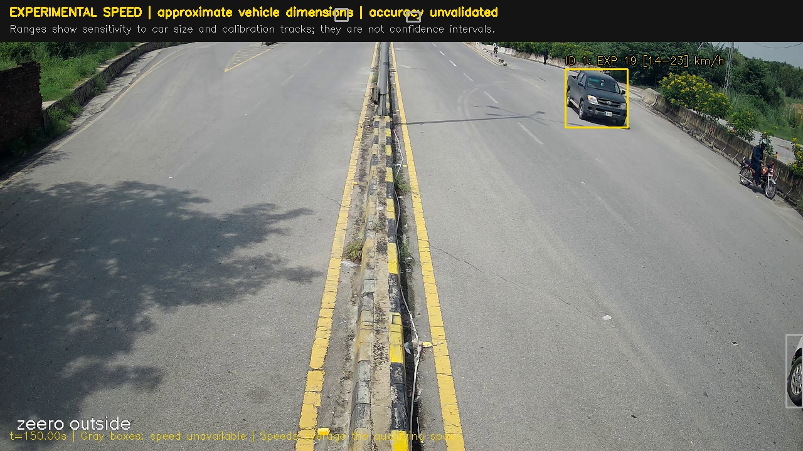
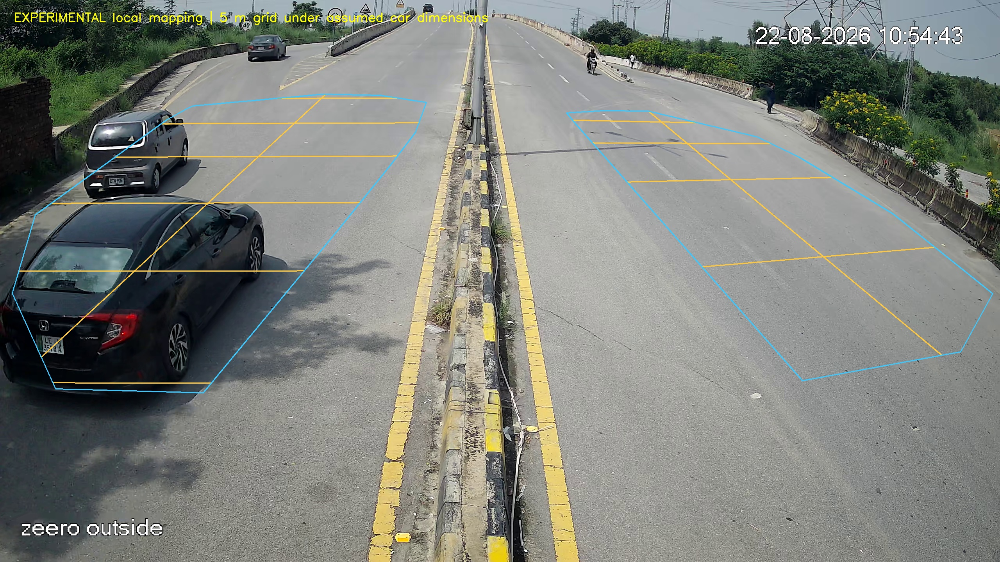
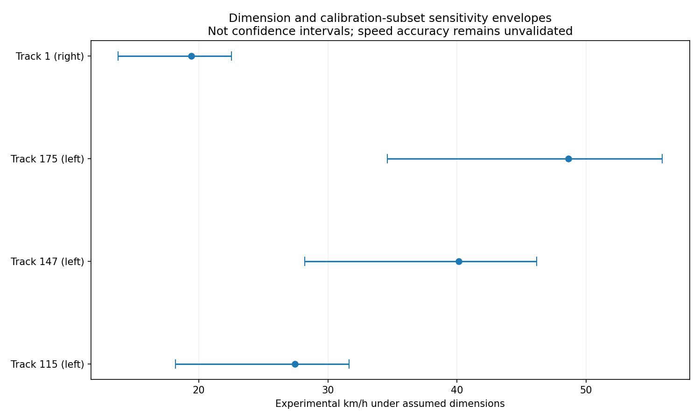
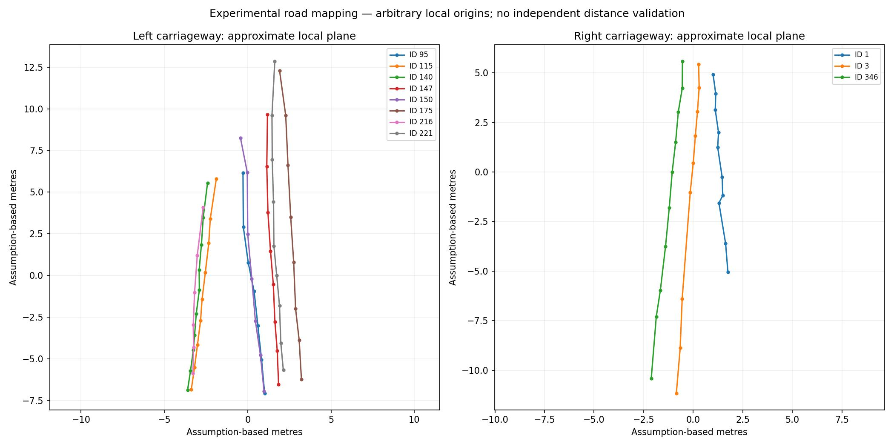

# Experimental speed-estimation outputs

This folder is the committed snapshot of the completed Kaggle experiment: source-video seconds **150–210**, **25 FPS**, 1,500 frames. Tracking notebook v1, geometry v2 and CPU speed v2 produced these artifacts. See [the feature README](../README.md) for reproduction and limitations.

**All speeds are provisional. Real speed accuracy is unvalidated. Ranges are dimension-and-fit sensitivity envelopes, not confidence intervals.** Four of eight candidate spans passed internal consistency screening; the full 12-minute video has not been processed for speeds.

[Open/download the 60-second H.264 preview](experimental_speed_preview.mp4) (1280 × 720, approximately 9.9 MB). Yellow labels show qualifying experimental speeds during their accepted spans; grey boxes have no accepted speed.

## Annotated example

## Local road mapping

The 5 m grid is a hypothesis under assumed car dimensions. The two carriageways use separate local mappings and origins. Only footprint-supported regions are drawn.

## Dimension and fit sensitivity

## Mapped trajectories

## Data and reports

| File | Contents |
|---|---|
| [qualified_experimental_speeds.csv](qualified_experimental_speeds.csv) | Four estimates passing the internal screens, ranges and fitted intervals |
| [vehicle_speed_estimates.json](vehicle_speed_estimates.json) | Qualified results for application integration, including `accuracy_validated: false` |
| [experimental_speeds.csv](experimental_speeds.csv) | All eight candidates, including failures and rejection reasons |
| [calibration.json](calibration.json) | Per-carriageway projective mappings and geometry diagnostics |
| [filtered_ground_footprints.json](filtered_ground_footprints.json) | The 93 footprints used for local fitting and speed candidates |
| [speed_run_report.json](speed_run_report.json) | Dimensions, scenarios, model hash, screening totals and limitations |
| [render_report.json](render_report.json) | Preview frame rate, duration and number of labelled frames |
| [manifest.json](manifest.json) | Run provenance and file checksums for this snapshot |
| [inputs/geometry/observations.json](inputs/geometry/observations.json) | 224 matched model observations, allowing CPU recalibration without footage |
| [inputs/geometry/geometry_run_report.json](inputs/geometry/geometry_run_report.json) | Geometry-model revision, hash, corner order and inference summary |
| [inputs/tracking/tracks.csv](inputs/tracking/tracks.csv) | Original per-frame detection and tracking rows for this minute |
| [inputs/tracking/track_summary.csv](inputs/tracking/track_summary.csv) | Baseline track summaries |
| [inputs/tracking/run_report.json](inputs/tracking/run_report.json) | Source metadata, detector/tracker settings and software versions |

The original CCTV recording and model weights are excluded. Regenerated local results go to the separate ignored `../outputs/` directory. These saved outputs demonstrate the prototype and must not be treated as ground-truth speed labels.
