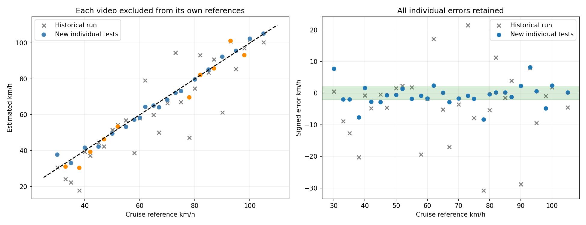

# Calibration research and per-video tests

Run date: 2026-10-16 (Asia/Karachi). All 30 Mercedes clips are tested separately. Text annotations are ignored.

**Individual test result: MAE 2.38 km/h; 19/30 within ±2 km/h; worst error 8.31 km/h.**

**These are development reruns of previously inspected videos. They are not a fresh independent validation set. Each test reference is excluded from calibration and automated configuration selection.**

## Research and implementations

| Research | Used in this experiment | Scope |
|---|---|---|
| [Revaud and Humenberger, ICCV 2021](https://github.com/naver/cctv) | Released learned mask-moment calibration network, direct and ensemble versions | Pinned upstream code/model; CC BY-NC-SA 3.0 retained; weights not redistributed |
| [Kocur and Ftáčnik, 2021](https://arxiv.org/abs/2103.11438) | Vehicle motion vanishing points constrain new geometric fits | Own optical-flow/line estimator; their trained DeepVP network was not run |
| [Su et al., 2026](https://arxiv.org/abs/2608.16785) | Compare optical flow with keypoint motion and update metric geometry | Inspired hybrid contact-anchor method; not a reproduction of their 36-keypoint network |
| [Fitzgibbon, 2001](https://www.robots.ox.ac.uk/~vgg/publications/2001/Fitzgibbon01b/fitzgibbon01b.pdf) | Division-model radial correction estimated from visual motion | Own nonlinear motion fit; not the paper’s two-view eigenvalue algorithm |
| [Vuong et al., WACV 2024](https://github.com/kvuong2711/OpenTrafficCam3D) | Considered scene-reconstruction calibration | Not run: required street-level/GPS imagery is absent |

Additional independently implemented candidates fit rigid cuboid motion, generic vehicle silhouettes, temporal front/rear delays, and reference-pass reciprocal road coordinates. No neural-network weights were fine-tuned. Vehicle dimensions remain priors, not a confirmed Mercedes CAD model.

## Pattern analysis

The historical 27-clip errors were not concentrated only at high speed: MAE was 7.49 km/h below 50, 11.64 at 50–79, and 8.17 at 80+. Correlation between reference speed and absolute error was approximately 0.086. These descriptive results do not establish causation. Unmatched camera views and inconsistent predicted hidden corners were stronger concerns.

The first GPU round compared ten versions on all 30 clips. Small image-fitting residuals did not guarantee accurate speed: the silhouette fits frequently selected incorrect focal lengths and scales. The learned network fitted the three pilots well after scale correction but transferred poorly to some other views. A two-dimensional projective time-delay method was more consistent. The second round added shared motion vanishing points, adaptive frame gaps, constant-motion rectification, a constrained 3D fit, and estimated radial distortion.

## Individual test protocol

1. Produce speed-blind geometry, mask moments and optical-flow measurements for every video.
2. For each test, remove its reference speed before fitting metric scale or selecting a configuration. The fixed 30/60/100 calibration pilots are used only when they remain in that fold.
3. Each eligible other video can supply a known-speed reference calibration. Scene matching and supported image locations decide whether it can be reused. A test is never its own reference.
4. Combine up to three strongest matching references, weighted by visual overlap. This aggregation reduces single-reference switching. Select its reference/geometry fusion weight using inner tests on the remaining 29 videos, excluding each inner test from its own references as well. Then predict the outer test.
5. Read the outer reference only to calculate its error. Retain all failures and unavailable results. This is internal development cross-validation on one car and location.

Reference-library results benefit from additional labelled reference passes. They must not be attributed solely to a new automatic calibration model. Raw geometry/model predictions are reported separately from pilot scale correction and from reference-library assistance.

## Every geometric/model version

Each row uses reference scale fitted from the designated pilots with that test excluded. Missing estimates count against coverage and the tolerance total.

| Version | Estimated / 30 | Raw MAE | Scale-corrected MAE | Worst corrected error | Within ±2 | Errors >10 |
|---|---:|---:|---:|---:|---:|---:|
| v2_delay_1d | 30/30 | 6.99 | 5.90 | 20.44 | 2 | 2 |
| v2b_delay_2d | 30/30 | 8.79 | 4.25 | 10.37 | 7 | 1 |
| v2c_corner_vp_delay | 30/30 | 9.07 | 4.21 | 9.32 | 6 | 0 |
| v2d_flow_vp_delay | 30/30 | 9.09 | 3.90 | 9.42 | 8 | 0 |
| v3_rigid_bundle | 30/30 | 6.28 | 4.78 | 11.26 | 5 | 1 |
| v3b_rigid_distortion | 30/30 | 6.75 | 4.97 | 13.32 | 5 | 2 |
| v4_learned_mask | 30/30 | 32.26 | 9.58 | 43.08 | 6 | 10 |
| v4b_learned_ensemble | 30/30 | 24.51 | 7.93 | 31.72 | 6 | 8 |
| v5_learned_flow | 30/30 | 39.01 | 6.03 | 23.80 | 11 | 7 |
| v5b_ensemble_flow | 30/30 | 30.36 | 6.27 | 21.32 | 4 | 4 |
| v5c_adaptive_learned_flow | 30/30 | 39.74 | 6.27 | 29.09 | 10 | 7 |
| v5d_constant_motion_refinement | 30/30 | 39.57 | 7.09 | 32.76 | 7 | 7 |
| v6_silhouette_cuboid | 30/30 | 28.00 | 6.40 | 23.20 | 5 | 6 |
| v6_silhouette_sedan | 30/30 | 42.88 | 8.74 | 25.20 | 8 | 13 |
| v7_adaptive_vp_delay | 30/30 | 9.08 | 3.90 | 9.42 | 8 | 0 |
| v7b_adaptive_vp_rigid | 30/30 | 6.33 | 4.67 | 11.11 | 6 | 1 |
| v7c_fitted_effective_length | 30/30 | 16.58 | 16.34 | 63.44 | 5 | 14 |
| v9_motion_lens_delay | 25/30 | 9.41 | 4.64 | 8.77 | 3 | 0 |

## Hybrid versions

Weights are the contribution of the reference-library estimate when a compatible reference exists; otherwise the vanishing-point temporal estimate is used. These fixed-version rows are development comparisons. Final individual tests use the weighted top-three reference family and select only its fusion weight within each training fold.

| Version | MAE km/h | Worst error | Within ±2 |
|---|---:|---:|---:|
| best_weight_0 | 3.90 | 9.42 | 8/30 |
| best_weight_0.25 | 3.28 | 8.88 | 12/30 |
| best_weight_0.5 | 2.74 | 8.64 | 17/30 |
| best_weight_0.75 | 2.39 | 8.40 | 19/30 |
| best_weight_1 | 2.55 | 8.31 | 19/30 |
| median_weight_0 | 3.90 | 9.42 | 8/30 |
| median_weight_0.25 | 3.39 | 8.88 | 12/30 |
| median_weight_0.5 | 2.89 | 8.64 | 16/30 |
| median_weight_0.75 | 2.51 | 8.40 | 18/30 |
| median_weight_1 | 2.59 | 8.31 | 18/30 |
| top3mean_weight_0 | 3.90 | 9.42 | 8/30 |
| top3mean_weight_0.25 | 3.33 | 8.65 | 11/30 |
| top3mean_weight_0.5 | 2.77 | 8.31 | 15/30 |
| top3mean_weight_0.75 | 2.33 | 8.31 | 20/30 |
| top3mean_weight_1 | 2.54 | 8.31 | 18/30 |
| top3weighted_weight_0 | 3.90 | 9.42 | 8/30 |
| top3weighted_weight_0.25 | 3.33 | 8.65 | 11/30 |
| top3weighted_weight_0.5 | 2.76 | 8.31 | 15/30 |
| top3weighted_weight_0.75 | 2.32 | 8.31 | 20/30 |
| top3weighted_weight_1 | 2.52 | 8.31 | 18/30 |

The frozen development configuration is **top3weighted_weight_0.75**. Its settings are in [selected_configuration.json](selected_configuration.json).

## Before and after

On the same previous 27 test clips, historical MAE was 9.41 km/h and this development cross-validation gives 2.21 km/h. The new hybrid can use other labelled reference passes, while the historical run used only three pilots. The datasets and training information therefore differ; this is not a new independent head-to-head validation.

## Each video and its two outputs

| Video / calibration | Cruise reference | Previous estimate | New estimate | New signed error | Within ±2 | Calibration reused |
|---|---:|---:|---:|---:|---|---|
| [MercedesAMG550_30.MP4](videos/MercedesAMG550_30/speed.mp4) · [calibration](videos/MercedesAMG550_30/calibration.mp4) | 30.0 | 30.6 | 37.7 | +7.74 | No | Yes |
| [MercedesAMG550_33.MP4](videos/MercedesAMG550_33/speed.mp4) · [calibration](videos/MercedesAMG550_33/calibration.mp4) | 33.0 | 24.1 | 31.1 | -1.93 | Yes | No |
| [MercedesAMG550_35.MP4](videos/MercedesAMG550_35/speed.mp4) · [calibration](videos/MercedesAMG550_35/calibration.mp4) | 35.0 | 22.3 | 33.1 | -1.94 | Yes | Yes |
| [MercedesAMG550_38.MP4](videos/MercedesAMG550_38/speed.mp4) · [calibration](videos/MercedesAMG550_38/calibration.mp4) | 38.0 | 17.7 | 30.4 | -7.62 | No | No |
| [MercedesAMG550_40.MP4](videos/MercedesAMG550_40/speed.mp4) · [calibration](videos/MercedesAMG550_40/calibration.mp4) | 40.0 | 39.3 | 41.6 | +1.63 | Yes | Yes |
| [MercedesAMG550_42.MP4](videos/MercedesAMG550_42/speed.mp4) · [calibration](videos/MercedesAMG550_42/calibration.mp4) | 42.0 | 37.2 | 39.3 | -2.69 | No | No |
| [MercedesAMG550_45.MP4](videos/MercedesAMG550_45/speed.mp4) · [calibration](videos/MercedesAMG550_45/calibration.mp4) | 45.0 | 44.6 | 42.2 | -2.77 | No | Yes |
| [MercedesAMG550_47.MP4](videos/MercedesAMG550_47/speed.mp4) · [calibration](videos/MercedesAMG550_47/calibration.mp4) | 47.0 | 42.4 | 46.3 | -0.65 | Yes | No |
| [MercedesAMG550_50.MP4](videos/MercedesAMG550_50/speed.mp4) · [calibration](videos/MercedesAMG550_50/calibration.mp4) | 50.0 | 51.6 | 49.5 | -0.51 | Yes | Yes |
| [MercedesAMG550_52.MP4](videos/MercedesAMG550_52/speed.mp4) · [calibration](videos/MercedesAMG550_52/calibration.mp4) | 52.0 | 54.4 | 53.4 | +1.41 | Yes | No |
| [MercedesAMG550_55.MP4](videos/MercedesAMG550_55/speed.mp4) · [calibration](videos/MercedesAMG550_55/calibration.mp4) | 55.0 | 56.8 | 53.2 | -1.77 | Yes | Yes |
| [MercedesAMG550_58.MP4](videos/MercedesAMG550_58/speed.mp4) · [calibration](videos/MercedesAMG550_58/calibration.mp4) | 58.0 | 38.6 | 57.2 | -0.78 | Yes | Yes |
| [MercedesAMG550_60.MP4](videos/MercedesAMG550_60/speed.mp4) · [calibration](videos/MercedesAMG550_60/calibration.mp4) | 60.0 | 58.1 | 58.3 | -1.69 | Yes | Yes |
| [MercedesAMG550_62.MP4](videos/MercedesAMG550_62/speed.mp4) · [calibration](videos/MercedesAMG550_62/calibration.mp4) | 62.0 | 79.1 | 64.4 | +2.40 | No | Yes |
| [MercedesAMG550_65.MP4](videos/MercedesAMG550_65/speed.mp4) · [calibration](videos/MercedesAMG550_65/calibration.mp4) | 65.0 | 59.8 | 65.1 | +0.10 | Yes | Yes |
| [MercedesAMG550_67.MP4](videos/MercedesAMG550_67/speed.mp4) · [calibration](videos/MercedesAMG550_67/calibration.mp4) | 67.0 | 50.0 | 64.2 | -2.84 | No | Yes |
| [MercedesAMG550_70.MP4](videos/MercedesAMG550_70/speed.mp4) · [calibration](videos/MercedesAMG550_70/calibration.mp4) | 70.0 | 66.4 | 68.3 | -1.66 | Yes | Yes |
| [MercedesAMG550_73.MP4](videos/MercedesAMG550_73/speed.mp4) · [calibration](videos/MercedesAMG550_73/calibration.mp4) | 73.0 | 94.5 | 72.2 | -0.79 | Yes | Yes |
| [MercedesAMG550_75.MP4](videos/MercedesAMG550_75/speed.mp4) · [calibration](videos/MercedesAMG550_75/calibration.mp4) | 75.0 | 67.2 | 73.2 | -1.80 | Yes | Yes |
| [MercedesAMG550_78.MP4](videos/MercedesAMG550_78/speed.mp4) · [calibration](videos/MercedesAMG550_78/calibration.mp4) | 78.0 | 47.2 | 69.7 | -8.31 | No | No |
| [MercedesAMG550_80.MP4](videos/MercedesAMG550_80/speed.mp4) · [calibration](videos/MercedesAMG550_80/calibration.mp4) | 80.0 | 74.7 | 79.7 | -0.33 | Yes | Yes |
| [MercedesAMG550_82.MP4](videos/MercedesAMG550_82/speed.mp4) · [calibration](videos/MercedesAMG550_82/calibration.mp4) | 82.0 | 93.2 | 82.2 | +0.22 | Yes | No |
| [MercedesAMG550_85.MP4](videos/MercedesAMG550_85/speed.mp4) · [calibration](videos/MercedesAMG550_85/calibration.mp4) | 85.0 | 83.5 | 85.2 | +0.20 | Yes | Yes |
| [MercedesAMG550_87.MP4](videos/MercedesAMG550_87/speed.mp4) · [calibration](videos/MercedesAMG550_87/calibration.mp4) | 87.0 | 90.9 | 85.8 | -1.16 | Yes | No |
| [MercedesAMG550_90.MP4](videos/MercedesAMG550_90/speed.mp4) · [calibration](videos/MercedesAMG550_90/calibration.mp4) | 90.0 | 61.2 | 92.4 | +2.36 | No | Yes |
| [MercedesAMG550_93.MP4](videos/MercedesAMG550_93/speed.mp4) · [calibration](videos/MercedesAMG550_93/calibration.mp4) | 93.0 | 100.9 | 101.2 | +8.20 | No | No |
| [MercedesAMG550_95.MP4](videos/MercedesAMG550_95/speed.mp4) · [calibration](videos/MercedesAMG550_95/calibration.mp4) | 95.0 | 85.5 | 95.6 | +0.64 | Yes | Yes |
| [MercedesAMG550_98.MP4](videos/MercedesAMG550_98/speed.mp4) · [calibration](videos/MercedesAMG550_98/calibration.mp4) | 98.0 | 97.1 | 93.2 | -4.75 | No | No |
| [MercedesAMG550_100.MP4](videos/MercedesAMG550_100/speed.mp4) · [calibration](videos/MercedesAMG550_100/calibration.mp4) | 100.0 | 101.9 | 102.4 | +2.40 | No | Yes |
| [MercedesAMG550_105.MP4](videos/MercedesAMG550_105/speed.mp4) · [calibration](videos/MercedesAMG550_105/calibration.mp4) | 105.0 | 100.5 | 105.2 | +0.24 | Yes | Yes |

## Files and reproduction

- [Per-video CSV](results.csv), [all version results](version_results.csv), [metrics](metrics.json), [raw metrics before reference scaling](raw_metrics.json), [fold predictions and reference lists](predictions.json).
- [Scene-registration evidence](scene_registrations.json), [reference calibrations](reference_calibrations.json), [reference options](reference_options.json), [raw version predictions](raw_predictions.json).
- `inputs/round1` and `inputs/round2` preserve the model/motion outputs. Original videos and all downloaded weights are excluded.
- Calibration videos review predicted nodes and the fitted longitudinal mapping. They do not claim a measured reconstruction of the entire road.
- Reproduce from the feature folder using `python calibration_comparison.py --inference-dir output/mercedes_validation/inference --first-round output/calibration_comparison/inputs/round1 --second-round output/calibration_comparison/inputs/round2 --output outputs/comparison_reproduction --no-render`. Add `--video-dir <original-folder>` and omit `--no-render` to render videos.

## Accuracy limit

The requested ±1–2 km/h accuracy is achieved only if every individual error supports it. The report preserves the remaining large errors. Cruise-control settings are reference values, not independently measured radar speeds. Reference-library transfer assumes a compatible local road projection; full-scene matching can still contain ground parallax or lens effects. Unknown views rely on approximate vehicle geometry. The Mercedes calibration must not be copied to the original CCTV camera.

**The requested accuracy target is still not met across all videos.**

## Final saved run and verification

The [GPU comparison](https://www.kaggle.com/code/hayyanfaisal/fyp-per-video-calibration-method-comparison) version 1 and [CPU refinement/report](https://www.kaggle.com/code/hayyanfaisal/fyp-calibration-refinement-report) version 3 completed successfully; both notebooks remain private. [Provenance](provenance.json) records the source revision, model hash and GPU software versions.

All **60 videos** passed decoded frame-count, rate, duration, size and H.264 checks against their source clips. All **30 individual test exclusions** were audited, including unique source hashes and the actual/eligible reference lists. See [artifact verification](artifact_verification.json) and [individual test audit](individual_test_audit.json).

The snapshot includes **540 geometric/model version rows** in [version_results.csv](version_results.csv) and **600 fixed fusion-configuration rows** in [fusion_version_results.csv](fusion_version_results.csv). The latter are fixed-configuration development comparisons; the main 30-row result uses nested selection with each test excluded. Tolerance counts use unrounded estimates.

The first hybrid selected a single reference. Fresh local/Kaggle pipelines changed one estimate by 2.43 km/h. Weighted aggregation of up to three references reduced the observed maximum difference to 0.96 km/h in this diagnostic. These numbers describe software-pipeline variation, not physical accuracy bounds. [Stability audit](matching_stability_audit.json) and [initial hybrid metrics](initial_hybrid_report_metrics.json) preserve the comparison.

Recalculation from the final saved inputs **and saved camera matches** agreed with Kaggle within 0.000001 km/h. See [reproduction verification](reproduction_verification.json). To preserve those matches, create `outputs/comparison_reproduction` and copy `scene_registrations.json` there before running the reproduction command. Fresh matching can select different correspondences.

The historical 30/60/100 km/h estimates were calibration-data fitting results. The new table treats those videos as tests with their own reference excluded. Their historical numbers are not independent baseline test measurements.

## Remaining errors by calibration path

| Path | Videos | MAE km/h | Worst error | Within ±2 |
|---|---:|---:|---:|---:|
| Reused reference calibration and geometry | 20 | 1.73 | 7.74 | 14/20 |
| New geometric calibration | 10 | 3.69 | 8.31 | 5/10 |

The 78 km/h clip now estimates 69.7 km/h, compared with 47.2 previously. It remains outside tolerance. The 93 km/h clip estimates 101.2 km/h. Both need the geometric fallback. Matched reference views can also fail; the individual table retains those cases.
