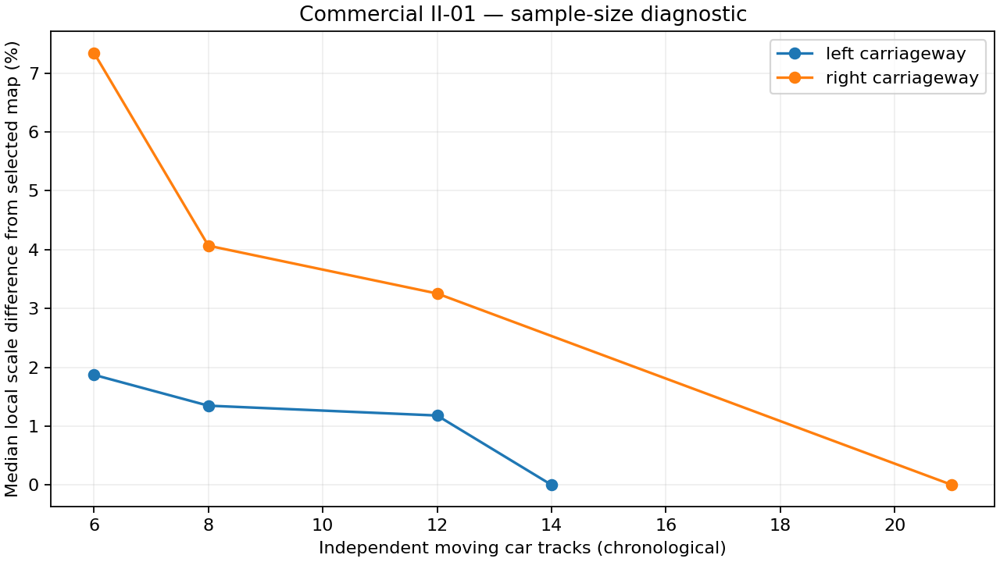
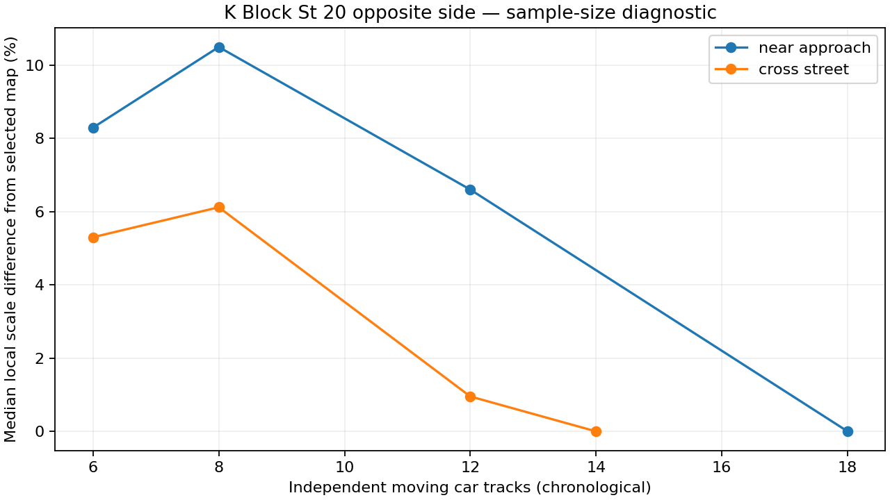

# Pilot patterns and calibration decisions

These are measurements of calibration consistency and observation availability. They are **not before/after speed accuracy measurements**: neither CCTV recording has a ground-truth speed reference. The Mercedes/Kia labelled-pass corrections are excluded.

## 1. Brief visibility needs both denser samples and a shorter eligibility span

K Block has many cars, but its close road view often holds a car for less than two seconds. Simply making the footage longer did not fix the original long-span filter. The following ablation uses the same unlabelled pilot footage, native checkpoint corner order, quality screens and road polygons:

| Geometry samples | Calibration eligibility | Near approach, first 5 min | Cross street, first 5 min | Near approach, first 15 min | Cross street, first 15 min |
|---|---|---:|---:|---:|---:|
| 2.5 FPS | ≥6 observations, ≥1.5 s movement | 1 | 3 | 1 | 4 |
| 2.5 FPS | ≥4 observations, ≥0.3 s movement | 2 | 5 | 2 | 8 |
| 10 FPS | ≥6 observations, ≥1.5 s movement | 3 | 6 | 3 | 8 |
| 10 FPS | ≥4 observations, ≥0.3 s movement | **18** | **14** | **38** | **26** |

All four settings still require adequate image movement and geometrically usable, unclipped footprints. Sampling and eligibility were changed together in the selected version; this table separates their effects. The final K Block mapping uses only the first five minutes. The longer pilot is also used for subsequent speed measurements and unlabelled temporal consistency checks.

The corresponding [ablation data](diagnostics/k_block_sampling_ablation.json) and [original low-rate pilot](pilot_history/k_block_initial_2_5fps/) are retained.

## 2. Enough independent cars matters more than repeated frames of one car

Each calibration track receives one aggregate fitting vote. Six bootstrapped 75% car subsets measure how much the local metric mapping changes when individual cars are removed.

| Region | Selected initial interval | Qualifying car tracks | Subset scale change, 90th percentile |
|---|---:|---:|---:|
| Commercial left | 5 min | 14 | 1.4% |
| Commercial right | 10 min | 21 | 2.8% |
| K Block near approach | 5 min | 18 | 4.4% |
| K Block cross street | 5 min | 14 | 4.2% |

The chronological car-count diagnostic compares smaller samples with the final selected map. Commercial right's first six cars differ by 7.35% in median local scale; the first 12 differ by 3.25%. K Block near approach's first eight cars differ by 10.49%; the first 12 differ by 6.60%. These are differences from a selected mapping, **not errors against the real road**. More cars need not improve a particular estimate monotonically.

## 3. Camera geometry and fleet-size priors need separate checks

An affine mapping performs poorly over Commercial's strong depth variation. Its rectangle/rigidity checks favor a projective mapping. The original projective fit fixes the overall median car length, but can still leave position-dependent inferred size differences. A second projective version adds soft 4.5 × 1.8 m length/width priors across cars.

Using the same held-out calibration tracks and the same scoring definition, Commercial left's held-out geometry score changes from 11.17 to 10.86; right changes from 8.30 to 7.37. Subset scale variation changes from 2.87% to 1.40% on the left and 5.74% to 2.82% on the right. The metric-prior version is selected there.

K Block favors the original projective version: its total selection scores are 16.67 versus 16.95 on the near approach and 10.24 versus 10.28 on the cross street. The soft-prior method is therefore not imposed on every region. Full comparisons are in each camera's calibration JSON.

Stronger regularization can make a mapping more stable while retaining a biased dimension prior. These results do not demonstrate improved real speed accuracy. The [original Commercial mapping](pilot_history/commercial_initial_projective/calibration.json) is preserved for comparison.

## 4. Frozen mappings remain consistent on later pilot cars

Later moving tracks, excluded from the selected calibration and restricted to its supported road patch, provide a temporal geometry check:

| Region | Later car track IDs | Later observations | Median rectangle-angle error |
|---|---:|---:|---:|
| Commercial left | 41 | 447 | 4.62° |
| Commercial right | 13 | 192 | 3.27° |
| K Block near approach | 19 | 181 | 6.31° |
| K Block cross street | 11 | 134 | 5.15° |

See [the saved temporal checks](diagnostics/temporal_geometry_check.json) and each camera's `diagnostics/calibration_stability.json`. These checks use the initial 15-minute pilot, not independently measured later speeds. Additional periodic static-view checks cover the full recordings and are recorded in each speed report.

## 5. Tracking and velocity need to reflect actual CCTV movement

The long recordings include turns, braking, stops, occlusion and parked cars. Speed is the local 2D road-plane trajectory derivative, rather than a constant linear velocity fitted across an entire pass. Long missing intervals and region changes split the calculation. Quadratic fits require observations on both sides; edge windows use linear fits. Quality screens reject unstable footprints, excessive fit residuals, unsupported regions and implausible inferred car sizes. No expected-speed clipping or known-speed correction is used.

Only qualified passenger-car footprints receive metric labels. Other tracked vehicle classes and unqualified car tracks remain grey. Track IDs can fragment and restart at the 15-minute processing boundary, so track counts are not guaranteed unique-vehicle counts.

## 6. The pinned model's actual format must be respected

An initial adapter expected per-keypoint confidence, but this pinned checkpoint outputs eight XY points. Its first four points form the lower ground face in both recordings, with 100% moving-track vote agreement in the pilots. The current upstream model card describes a different convention. The corrected adapter retains checkpoint edge topology and does not fabricate missing confidence values.

The original Commercial pilot v1 and low-rate K Block v1 reports contain an incorrect preset `ground_indices` diagnostic. Their raw eight-point observations are retained unchanged; the selected calibration's `ground_order` field is authoritative. This format correction happened before the full speed runs. It is a software compatibility fix, not a demonstrated improvement in network accuracy.

## 7. Source decoding and exported-video integrity

The original Commercial recording emitted two H.264 CABAC/qscale warning events and macroblock errors during local sequential decoding. OpenCV still returned all 90,000 source frames; the affected timestamps are unavailable, and source decoding may include concealment artifacts. The original file was not modified. Its final seven exported MP4s independently decode all 105,000 output frames, including the calibration replay, without decoder errors. Source and output integrity checks are separate from speed accuracy checks.

K Block's earlier random-access preflight produced HEVC reference warnings at seeks. Inference and full rendering use sequential decoding. Final exported-frame decoding, source hashes and periodic view checks are recorded in [verification](verification.json). Commercial's renderer details and source-warning note are in [local render provenance](provenance/local_commercial_render.json).

## Remaining accuracy limits

Unknown car dimensions supply an uncertain absolute scale. Mixed vehicle types, road slopes or grade changes, lens distortion, partial occlusion and ground-point prediction errors can cause errors beyond the displayed ±20% scale sensitivity. The range is not a confidence interval. A known dimension or independently measured distance/speed would be needed to quantify absolute error for these cameras. The grid represents a supported local road patch; it does not independently recover the entire road length or physical camera pitch.
