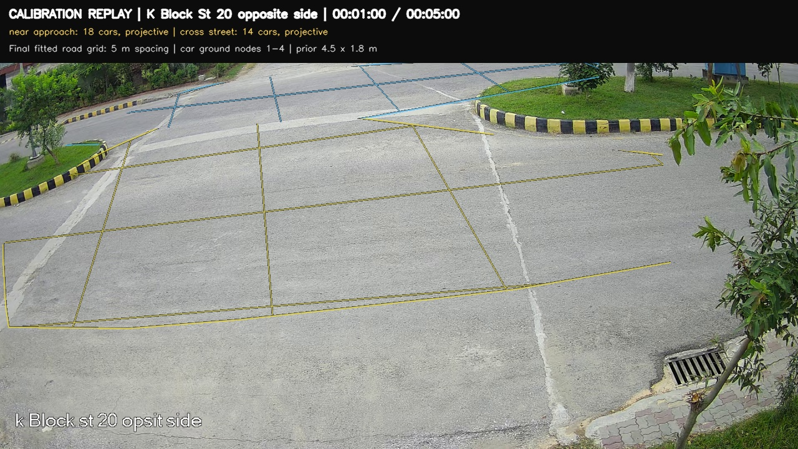
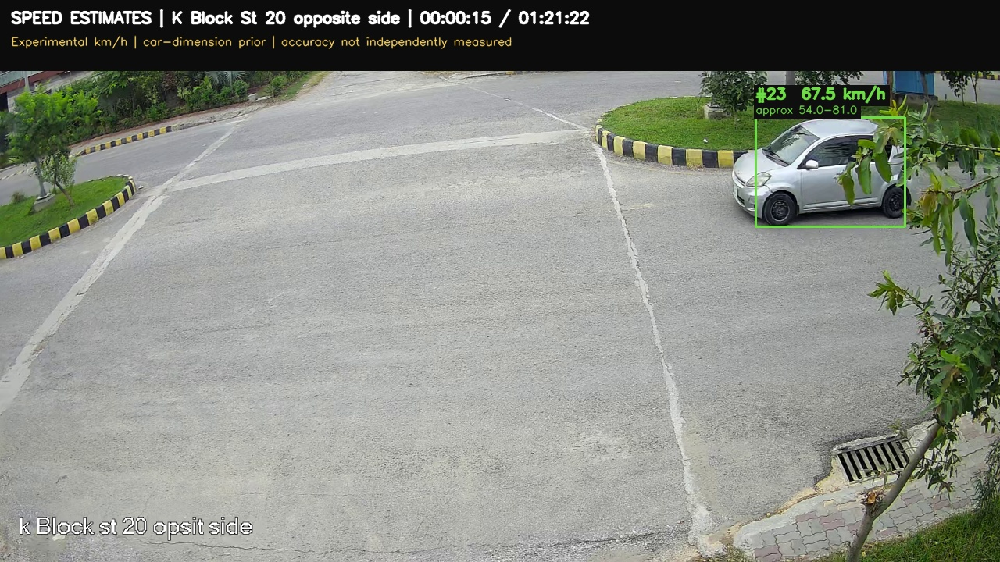
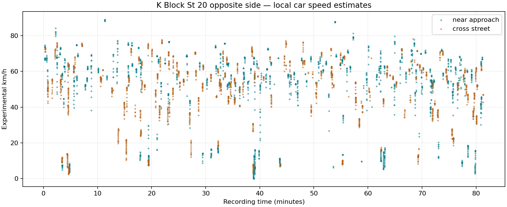
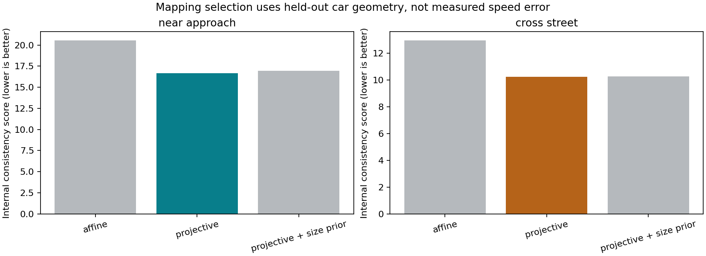
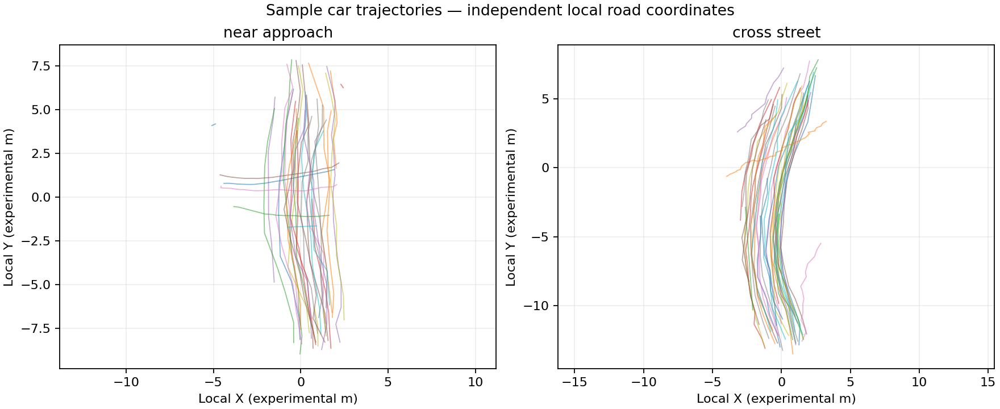

# K Block St 20 opposite side: full CCTV experiment

Processed **01:21:22**, all **97,641 source frames**, at **20 FPS**. The annotated speed video covers the complete recording; its ordered parts are below. Resolution is 1280 × 720, H.264, without audio.

**Experimental speeds, not independently validated.** No measured speed or road-distance reference is available for this camera. MAE, accuracy improvement and ±1–2 km/h compliance cannot be calculated from these recordings. Decimal display precision does not establish measurement accuracy.

## Calibration video

[Open/download the separate calibration replay](videos/calibration.mp4) — 00:05:00. It shows the final selected road grid and predicted ground nodes over the initial calibration interval. This is an offline replay, rather than a claim that the final mapping was known before collecting those cars.

| Road region | Initial interval | Qualifying car tracks | Selected fit | Car-subset scale change, 90th percentile |
|---|---:|---:|---|---:|
| near approach | 5 min | 18 | projective | 4.4% |
| cross street | 5 min | 14 | projective | 4.2% |

Each region is selected independently from 5-, 10- and 15-minute candidates. Subset changes describe internal stability, not ground-truth speed error. A nominal 4.5 × 1.8 m car supplies the metre scale. Road polygons are selected manually. Only the calibrated local patch is mapped; physical camera pitch and the entire road length are not independently measured.

## Complete speed video

| Source-video interval | Ordered video part | Frames |
|---|---|---:|
| 00:00:00–00:10:00 | [speed_00.mp4](videos/speed_00.mp4) | 12,000 |
| 00:10:00–00:20:00 | [speed_01.mp4](videos/speed_01.mp4) | 12,000 |
| 00:20:00–00:30:00 | [speed_02.mp4](videos/speed_02.mp4) | 12,000 |
| 00:30:00–00:40:00 | [speed_03.mp4](videos/speed_03.mp4) | 12,000 |
| 00:40:00–00:50:00 | [speed_04.mp4](videos/speed_04.mp4) | 12,000 |
| 00:50:00–01:00:00 | [speed_05.mp4](videos/speed_05.mp4) | 12,000 |
| 01:00:00–01:10:00 | [speed_06.mp4](videos/speed_06.mp4) | 12,000 |
| 01:10:00–01:20:00 | [speed_07.mp4](videos/speed_07.mp4) | 12,000 |
| 01:20:00–01:21:22 | [speed_08.mp4](videos/speed_08.mp4) | 1,641 |

**355 car track IDs** have **3,739 qualified local speed samples**. Track IDs may fragment and reset at 15 minutes; this is not a verified unique-vehicle count. Turning and accelerating vehicles receive local estimates instead of one constant speed for their entire pass. Grey boxes have no qualified metric estimate. Motorcycles, buses and trucks remain tracking-only.

The secondary range tests car-subset mapping variation and ±20% scale changes. It is a sensitivity envelope, not a confidence interval or a guarantee that true speed falls inside it. Unknown vehicle dimensions, lens distortion, road slopes and ground-point errors remain unresolved absolute-accuracy limits.

## Tables and checks

- [Every qualified speed sample](speed/speed_samples.csv) and [per-track summary](speed/track_summary.csv).
- [Calibration matrices, method comparison and window history](calibration/calibration.json).
- [Speed calculation, filters and periodic camera-view checks](speed/speed_report.json).
- [Complete video frame/duration manifest](videos/video_manifest.json).
- [Pilot measurements](measurements/pilot/) and [remaining-recording measurements](measurements/remainder/).

See [the two-camera report](../README.md) and [method/reproduction notes](../../../cctv_method.md). Camera-specific limitation: Junction and near approach calibrated separately. Speeds are local 2D trajectory derivatives, allowing turns and changes in speed.
