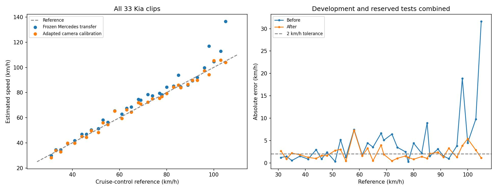
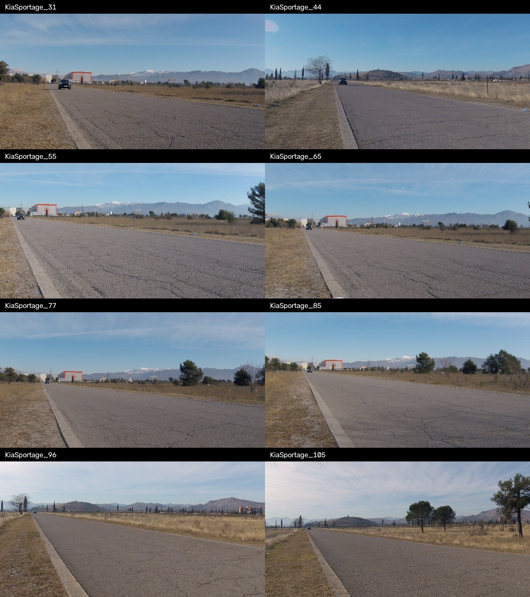

# Kia Sportage: cross-vehicle calibration tests

Run date: 2026-10-16 (Asia/Karachi). All 33 clips are separate tests. Filename speeds are constant cruise-control references, confirmed by the user. Text annotation files are ignored.

**Primary result: the 25 reserved clips, evaluated after the method was frozen.**

| Group | Before MAE | After MAE | After within ±2 km/h | Worst after error |
|---|---:|---:|---:|---:|
| Eight development clips (leave-one-out calibration; used for method selection) | 6.98 | 1.17 | 7/8 | 2.67 |
| 25 reserved clips (not used for method selection) | 3.81 | 2.36 | 13/25 | 7.28 |
| All 33 (mixed summary) | 4.58 | 2.07 | 20/33 | 7.28 |

Selected method: **geometry_ensemble_50**. The ±2 km/h target across every reserved clip is **not met**.

The before result transfers the frozen Mercedes configuration and its 30-pass reference library to the Kia. The adapted result can use eight additional known-speed Kia reference passes. These are different calibration inputs: improvement must not be attributed solely to a better automatic model. The reserved clips share the same location and Kia recording session; they do not establish accuracy at a new camera or site.

## Protocol and versions

The [experiment plan](../../kia_experiment_plan.json) declared the eight development clips and 25 reserved clips before Kia errors were examined. Every development test excludes its own speed and reference calibration. The selected method and source hashes were then frozen in [configuration.json](configuration.json), before the reserved errors were calculated. No reserved speed enters a calibration fit or method selection. No neural-network weights were fine-tuned.

New comparisons separate a vehicle-length prior, an expanded reference library using the previous model, lower-image scene registration, shared reciprocal camera maps from optical flow, shared trajectory fitting, a lens-aware trajectory fit, and quadratic/cubic local scale curves. The second round adds per-video SUV template/lens fits and native/SUV geometry ensembles. The ensemble corrects each template’s metric scale from other known-speed Kia passes, then combines their independent per-video camera fits. This empirical template correction is vehicle-specific and is not automatic identification of the true dimensions. Unavailable shared maps fall back explicitly to the frozen baseline. Such fallbacks remain in the error totals.

The approximate 4.485 m Kia length comes from a [2021 Kia specification](https://www.kia.com/content/dam/kwcms/kme/it/it/assets/contents/utility/price-list/2021/03/Listino_Kia_Sportage_Pubblico_01_03_2021.pdf). The exact year/trim is unconfirmed, so this is a dimension prior, not an identified vehicle measurement. The filenames and speeds match the [VS13 paper](https://slobodan.ucg.ac.me/science/vs13/paper.pdf), which describes one Kia and three Mercedes recording sessions. That match is supporting context, not a byte-level source-identification claim.

| Development version | MAE km/h | Within ±2 | Worst error |
|---|---:|---:|---:|
| frozen_mercedes_baseline | 6.98 | 2/8 | 31.65 |
| vehicle_length_prior | 5.06 | 2/8 | 20.08 |
| expanded_reference_library | 6.98 | 2/8 | 31.65 |
| foreground_reference_library | 6.33 | 3/8 | 31.65 |
| shared_flow | 6.96 | 2/8 | 31.65 |
| shared_trajectory | 6.93 | 2/8 | 31.65 |
| shared_trajectory_radial | 6.98 | 2/8 | 31.65 |
| shared_curve2 | 7.08 | 1/8 | 31.65 |
| shared_curve3 | 7.07 | 1/8 | 31.65 |
| geometry_native | 1.97 | 5/8 | 4.92 |
| geometry_suv | 1.71 | 6/8 | 7.11 |
| geometry_temporal | 3.25 | 2/8 | 6.91 |
| geometry_ensemble_25 | 1.39 | 6/8 | 4.10 |
| geometry_ensemble_50 | 1.17 | 7/8 | 2.67 |
| geometry_ensemble_75 | 1.44 | 7/8 | 2.75 |

All 18 previous physical/model versions and six new geometry ablations are retained per clip in each group’s `physical_version_results.csv`. Previous versions show their Mercedes-transferred scale; new ablations retain raw values and have no Mercedes scale if no corresponding pilot exists. These diagnostics were not used to change the chosen method after reserved evaluation.

## Patterns

| Speed band (all 33; descriptive) | Before MAE | After MAE | After within ±2 |
|---|---:|---:|---:|
| below_50 | 1.46 | 1.62 | 6/8 |
| 50_to_79 | 3.71 | 2.22 | 8/13 |
| 80_plus | 7.60 | 2.22 | 6/12 |

Detailed signed errors, reference reuse, fallbacks and software/model provenance are retained. Correlation and band summaries describe patterns; they do not prove a cause.

## Each video and its calibration/speed outputs

| Clip / outputs | Group | Reference | Before | After | Signed error | Within ±2 |
|---|---|---:|---:|---:|---:|---|
| [KiaSportage_31.MP4](videos/KiaSportage_31/speed.mp4) · [calibration](videos/KiaSportage_31/calibration.mp4) | development | 31.0 | 29.8 | 28.3 | -2.67 | No |
| [KiaSportage_33.MP4](videos/KiaSportage_33/speed.mp4) · [calibration](videos/KiaSportage_33/calibration.mp4) | reserved | 33.0 | 34.5 | 33.9 | +0.86 | Yes |
| [KiaSportage_35.MP4](videos/KiaSportage_35/speed.mp4) · [calibration](videos/KiaSportage_35/calibration.mp4) | reserved | 35.0 | 34.5 | 32.8 | -2.18 | No |
| [KiaSportage_38.MP4](videos/KiaSportage_38/speed.mp4) · [calibration](videos/KiaSportage_38/calibration.mp4) | reserved | 38.0 | 39.5 | 39.8 | +1.81 | Yes |
| [KiaSportage_41.MP4](videos/KiaSportage_41/speed.mp4) · [calibration](videos/KiaSportage_41/calibration.mp4) | reserved | 41.0 | 41.9 | 39.8 | -1.23 | Yes |
| [KiaSportage_44.MP4](videos/KiaSportage_44/speed.mp4) · [calibration](videos/KiaSportage_44/calibration.mp4) | development | 44.0 | 46.9 | 45.0 | +0.97 | Yes |
| [KiaSportage_46.MP4](videos/KiaSportage_46/speed.mp4) · [calibration](videos/KiaSportage_46/calibration.mp4) | reserved | 46.0 | 46.9 | 44.4 | -1.65 | Yes |
| [KiaSportage_48.MP4](videos/KiaSportage_48/speed.mp4) · [calibration](videos/KiaSportage_48/calibration.mp4) | reserved | 48.0 | 50.4 | 49.6 | +1.63 | Yes |
| [KiaSportage_51.MP4](videos/KiaSportage_51/speed.mp4) · [calibration](videos/KiaSportage_51/calibration.mp4) | reserved | 51.0 | 51.3 | 48.2 | -2.77 | No |
| [KiaSportage_53.MP4](videos/KiaSportage_53/speed.mp4) · [calibration](videos/KiaSportage_53/calibration.mp4) | reserved | 53.0 | 58.2 | 56.0 | +3.01 | No |
| [KiaSportage_55.MP4](videos/KiaSportage_55/speed.mp4) · [calibration](videos/KiaSportage_55/calibration.mp4) | development | 55.0 | 56.3 | 54.6 | -0.41 | Yes |
| [KiaSportage_58.MP4](videos/KiaSportage_58/speed.mp4) · [calibration](videos/KiaSportage_58/calibration.mp4) | reserved | 58.0 | 65.4 | 65.3 | +7.28 | No |
| [KiaSportage_61.MP4](videos/KiaSportage_61/speed.mp4) · [calibration](videos/KiaSportage_61/calibration.mp4) | reserved | 61.0 | 62.8 | 59.4 | -1.58 | Yes |
| [KiaSportage_63.MP4](videos/KiaSportage_63/speed.mp4) · [calibration](videos/KiaSportage_63/calibration.mp4) | reserved | 63.0 | 67.4 | 66.3 | +3.25 | No |
| [KiaSportage_65.MP4](videos/KiaSportage_65/speed.mp4) · [calibration](videos/KiaSportage_65/calibration.mp4) | development | 65.0 | 68.5 | 64.5 | -0.46 | Yes |
| [KiaSportage_68.MP4](videos/KiaSportage_68/speed.mp4) · [calibration](videos/KiaSportage_68/calibration.mp4) | reserved | 68.0 | 74.6 | 72.0 | +3.97 | No |
| [KiaSportage_69.MP4](videos/KiaSportage_69/speed.mp4) · [calibration](videos/KiaSportage_69/calibration.mp4) | reserved | 69.0 | 74.1 | 70.9 | +1.89 | Yes |
| [KiaSportage_72.MP4](videos/KiaSportage_72/speed.mp4) · [calibration](videos/KiaSportage_72/calibration.mp4) | reserved | 72.0 | 78.4 | 72.4 | +0.44 | Yes |
| [KiaSportage_74.MP4](videos/KiaSportage_74/speed.mp4) · [calibration](videos/KiaSportage_74/calibration.mp4) | reserved | 74.0 | 77.5 | 75.0 | +1.03 | Yes |
| [KiaSportage_77.MP4](videos/KiaSportage_77/speed.mp4) · [calibration](videos/KiaSportage_77/calibration.mp4) | development | 77.0 | 79.5 | 75.5 | -1.53 | Yes |
| [KiaSportage_78.MP4](videos/KiaSportage_78/speed.mp4) · [calibration](videos/KiaSportage_78/calibration.mp4) | reserved | 78.0 | 78.3 | 76.8 | -1.21 | Yes |
| [KiaSportage_80.MP4](videos/KiaSportage_80/speed.mp4) · [calibration](videos/KiaSportage_80/calibration.mp4) | reserved | 80.0 | 84.4 | 79.2 | -0.80 | Yes |
| [KiaSportage_83.MP4](videos/KiaSportage_83/speed.mp4) · [calibration](videos/KiaSportage_83/calibration.mp4) | reserved | 83.0 | 85.1 | 84.4 | +1.41 | Yes |
| [KiaSportage_85.MP4](videos/KiaSportage_85/speed.mp4) · [calibration](videos/KiaSportage_85/calibration.mp4) | development | 85.0 | 93.9 | 86.0 | +1.00 | Yes |
| [KiaSportage_86.MP4](videos/KiaSportage_86/speed.mp4) · [calibration](videos/KiaSportage_86/calibration.mp4) | reserved | 86.0 | 84.5 | 83.9 | -2.06 | No |
| [KiaSportage_89.MP4](videos/KiaSportage_89/speed.mp4) · [calibration](videos/KiaSportage_89/calibration.mp4) | reserved | 89.0 | 85.9 | 86.6 | -2.37 | No |
| [KiaSportage_91.MP4](videos/KiaSportage_91/speed.mp4) · [calibration](videos/KiaSportage_91/calibration.mp4) | reserved | 91.0 | 89.5 | 89.7 | -1.29 | Yes |
| [KiaSportage_93.MP4](videos/KiaSportage_93/speed.mp4) · [calibration](videos/KiaSportage_93/calibration.mp4) | reserved | 93.0 | 92.1 | 89.7 | -3.26 | No |
| [KiaSportage_96.MP4](videos/KiaSportage_96/speed.mp4) · [calibration](videos/KiaSportage_96/calibration.mp4) | development | 96.0 | 99.8 | 97.3 | +1.26 | Yes |
| [KiaSportage_98.MP4](videos/KiaSportage_98/speed.mp4) · [calibration](videos/KiaSportage_98/calibration.mp4) | reserved | 98.0 | 116.9 | 94.2 | -3.84 | No |
| [KiaSportage_100.MP4](videos/KiaSportage_100/speed.mp4) · [calibration](videos/KiaSportage_100/calibration.mp4) | reserved | 100.0 | 104.5 | 105.4 | +5.37 | No |
| [KiaSportage_103.MP4](videos/KiaSportage_103/speed.mp4) · [calibration](videos/KiaSportage_103/calibration.mp4) | reserved | 103.0 | 112.8 | 105.8 | +2.85 | No |
| [KiaSportage_105.MP4](videos/KiaSportage_105/speed.mp4) · [calibration](videos/KiaSportage_105/calibration.mp4) | development | 105.0 | 136.7 | 103.9 | -1.10 | Yes |

## Evidence and limits

- [Full numeric results](results.csv) and [group metrics](metrics.json).
- [Development results](development/results.csv), [reserved results](reserved/results.csv), and their full predictions/reference lists.
- [Speed-band diagnostics](patterns.json), [verification](artifact_verification.json), and [provenance](provenance.json).
- The speed videos show an estimated constant pass speed to one decimal place. Calibration videos show predicted vehicle ground nodes and local distance marks; they are not a complete survey of the road.
- Cruise-control settings are the evaluation reference. Results are reference-assisted research on these recordings, with a reserved same-session check.

## Development history and final verification

The first adaptation round tested shared camera maps, reference-library changes and a size-only correction. Its best eight-clip development MAE was 5.06 km/h; the initial results are retained in [development_initial/metrics.json](development_initial/metrics.json). The next round added SUV camera/lens fits and template ensembles. The selected ensemble reached 1.17 km/h on development, then 2.36 km/h on the 25 reserved clips. The latter is the primary generalization check; no adjustment followed its errors.

[Detailed calibration patterns and Mercedes cross-checks](PATTERNS.md) include ground-observation counts, lens-fit bounds, compatible references and the worst remaining clips. These are descriptive analyses added after evaluation, not inputs to model selection.

[Reproduction verification](reproduction_verification.json) records **zero difference** between local and Kaggle baseline/selected estimates and confirms all 33 source-video hashes match the predeclared plan. Twelve physical/exclusion tests passed. [Artifact verification](artifact_verification.json) checks every video's decoded frame count, FPS, duration and H.264 format, plus all calibration-reference exclusions and frozen metric scales.

To reproduce the numeric reserved evaluation, follow the commands in the [feature README](../../README.md). `analyze_cross_vehicle_patterns.py --output output/kia_validation` recreates the descriptive diagnostics. Full video regeneration is packaged in `build_kia_report_notebook.py`; the private report notebook uses the saved reference data and locked configuration.

The inherited video caption `Development test` identifies the research experiment. Each clip’s specific `development` or `reserved` group is recorded in the table and `render_report.json`; the 25 reserved references were not used for calibration or selection.
