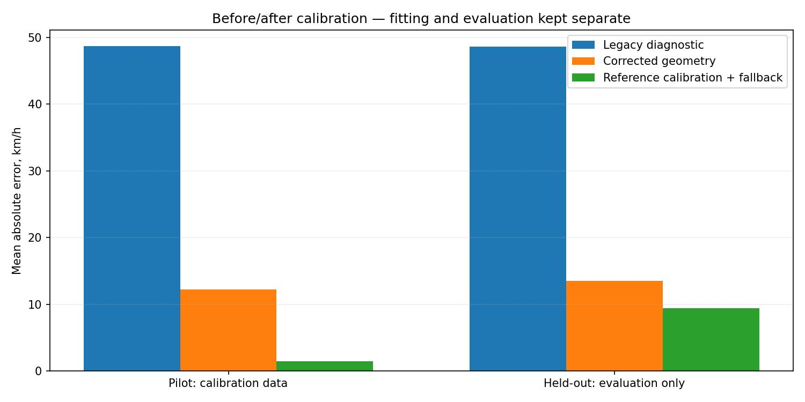
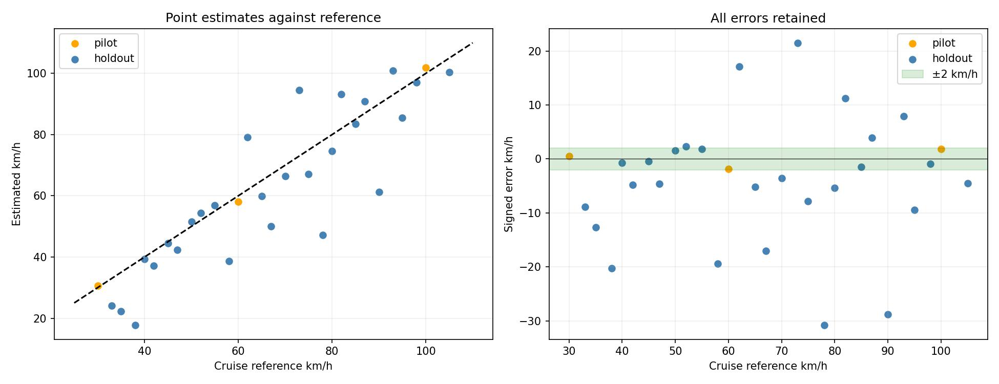

# Mercedes speed validation report

This is the preserved earlier experiment. See the [subsequent calibration-method comparison and individual tests](../calibration_comparison/README.md) for the new implementations, reference-library hybrid and paired output videos. The new experiments reuse these clips and are development cross-validation.

Run date: 2026-10-16 (Asia/Karachi). References are the user-confirmed cruise-control settings in filenames. Text annotation files are ignored.

**Held-out result: MAE 9.41 km/h; 6/27 clips within ±2 km/h; 27/27 estimated.**

**The requested ±1–2 km/h accuracy target is not met.** The largest error was the 78 km/h clip estimated as 47.2 km/h. Decimal display is a presentation choice and does not imply measurement accuracy.

## Protocol

The first development clips were 30, 60 and 100 km/h. They were used to diagnose geometry and fit the reference-assisted calibration. The remaining 27 speeds were reserved for evaluation; their reference speeds are read only after each prediction is produced. Calibration, model hashes and configuration are saved in [frozen_calibration.json](frozen_calibration.json).

Pilot fitting results are not independent accuracy measurements. The held-out set still shares the same car and recording location, so it does not establish performance on other cars or the original CCTV camera.

## What changed

1. The video now displays a single point estimate with one decimal place. Sensitivity ranges remain in the original CCTV data files.
2. Separate calibration-review and speed-estimation videos are produced for each evaluated clip.
3. Ground-corner ordering now follows the checkpoint topology instead of selecting length edges from image motion; that heuristic frequently selected width edges in the roadside view.
4. Projective normalization is centred on observed footprints and the solver permits low-camera perspectives with a horizon near image centre. A synthetic regression test covers that case.
5. Reference-assisted calibration uses only the three pilot speeds and constant-motion trajectories. It is transferred only through verified road-texture registration. Unmatched views use an explicitly labelled automatic single-pass geometry estimate.
6. A single physical distance-scale multiplier of 1.018574 was fitted using the three pilots to minimize their worst absolute error. It was frozen before the held-out comparison. This changed the pilot estimates from approximately 30.00/57.08/100.01 to 30.56/58.14/101.86 km/h.

No neural-network weights were fine-tuned. These are calibration and estimation changes. The single-pass fallback uses an assumed 4.9 m × 1.87 m vehicle prior; exact vehicle dimensions were not independently confirmed.

## Before and after

The original production workflow cannot calibrate a clip containing only one car track: it requires three tracks. Legacy numbers below are explicitly **single-pass diagnostic estimates** made by relaxing that eligibility rule, not outputs that passed the old production checks.

| Split | Legacy diagnostic MAE | Corrected geometry MAE | Final MAE | Final within ±2 km/h |
|---|---:|---:|---:|---:|
| pilot | 48.69 | 12.19 | 1.43 | 3/3 |
| holdout | 48.66 | 13.50 | 9.41 | 6/27 |
| all | 48.66 | 13.37 | 8.61 | 9/30 |

## Held-out results by calibration path

| Calibration path | Clips | MAE km/h | Maximum error | Within ±2 |
|---|---:|---:|---:|---:|
| automatic_single_pass_geometry | 16 | 13.25 | 30.78 | 1/16 |
| reference_assisted_registered_road | 11 | 3.82 | 9.47 | 5/11 |

## Every clip

| Clip / videos | Split | Reference | Initial diagnostic | Corrected geometry | Final estimate | Signed error | Within ±2 |
|---|---|---:|---:|---:|---:|---:|---|
| [MercedesAMG550_30.MP4](videos/MercedesAMG550_30/speed.mp4) · [calibration](videos/MercedesAMG550_30/calibration.mp4) | pilot | 30.0 | 12.25 | 28.76 | 30.56 | 0.56 | Yes |
| [MercedesAMG550_33.MP4](videos/MercedesAMG550_33/speed.mp4) · [calibration](videos/MercedesAMG550_33/calibration.mp4) | holdout | 33.0 | 38.58 | 24.11 | 24.11 | -8.89 | No |
| [MercedesAMG550_35.MP4](videos/MercedesAMG550_35/speed.mp4) · [calibration](videos/MercedesAMG550_35/calibration.mp4) | holdout | 35.0 | 9.87 | 22.33 | 22.33 | -12.67 | No |
| [MercedesAMG550_38.MP4](videos/MercedesAMG550_38/speed.mp4) · [calibration](videos/MercedesAMG550_38/calibration.mp4) | holdout | 38.0 | 7.76 | 17.75 | 17.75 | -20.25 | No |
| [MercedesAMG550_40.MP4](videos/MercedesAMG550_40/speed.mp4) · [calibration](videos/MercedesAMG550_40/calibration.mp4) | holdout | 40.0 | 9.39 | 33.83 | 39.25 | -0.75 | Yes |
| [MercedesAMG550_42.MP4](videos/MercedesAMG550_42/speed.mp4) · [calibration](videos/MercedesAMG550_42/calibration.mp4) | holdout | 42.0 | 9.29 | 37.18 | 37.18 | -4.82 | No |
| [MercedesAMG550_45.MP4](videos/MercedesAMG550_45/speed.mp4) · [calibration](videos/MercedesAMG550_45/calibration.mp4) | holdout | 45.0 | 9.08 | 35.72 | 44.55 | -0.45 | Yes |
| [MercedesAMG550_47.MP4](videos/MercedesAMG550_47/speed.mp4) · [calibration](videos/MercedesAMG550_47/calibration.mp4) | holdout | 47.0 | 18.54 | 42.42 | 42.42 | -4.58 | No |
| [MercedesAMG550_50.MP4](videos/MercedesAMG550_50/speed.mp4) · [calibration](videos/MercedesAMG550_50/calibration.mp4) | holdout | 50.0 | 11.29 | 41.37 | 51.56 | 1.56 | Yes |
| [MercedesAMG550_52.MP4](videos/MercedesAMG550_52/speed.mp4) · [calibration](videos/MercedesAMG550_52/calibration.mp4) | holdout | 52.0 | 27.79 | 54.36 | 54.36 | 2.36 | No |
| [MercedesAMG550_55.MP4](videos/MercedesAMG550_55/speed.mp4) · [calibration](videos/MercedesAMG550_55/calibration.mp4) | holdout | 55.0 | 9.83 | 42.44 | 56.83 | 1.83 | Yes |
| [MercedesAMG550_58.MP4](videos/MercedesAMG550_58/speed.mp4) · [calibration](videos/MercedesAMG550_58/calibration.mp4) | holdout | 58.0 | 9.68 | 38.60 | 38.60 | -19.40 | No |
| [MercedesAMG550_60.MP4](videos/MercedesAMG550_60/speed.mp4) · [calibration](videos/MercedesAMG550_60/calibration.mp4) | pilot | 60.0 | 11.97 | 42.71 | 58.14 | -1.86 | Yes |
| [MercedesAMG550_62.MP4](videos/MercedesAMG550_62/speed.mp4) · [calibration](videos/MercedesAMG550_62/calibration.mp4) | holdout | 62.0 | 77.77 | 79.06 | 79.06 | 17.06 | No |
| [MercedesAMG550_65.MP4](videos/MercedesAMG550_65/speed.mp4) · [calibration](videos/MercedesAMG550_65/calibration.mp4) | holdout | 65.0 | 13.81 | 51.36 | 59.84 | -5.16 | No |
| [MercedesAMG550_67.MP4](videos/MercedesAMG550_67/speed.mp4) · [calibration](videos/MercedesAMG550_67/calibration.mp4) | holdout | 67.0 | 15.15 | 50.01 | 50.01 | -16.99 | No |
| [MercedesAMG550_70.MP4](videos/MercedesAMG550_70/speed.mp4) · [calibration](videos/MercedesAMG550_70/calibration.mp4) | holdout | 70.0 | 13.91 | 56.17 | 66.44 | -3.56 | No |
| [MercedesAMG550_73.MP4](videos/MercedesAMG550_73/speed.mp4) · [calibration](videos/MercedesAMG550_73/calibration.mp4) | holdout | 73.0 | 99.70 | 94.51 | 94.51 | 21.51 | No |
| [MercedesAMG550_75.MP4](videos/MercedesAMG550_75/speed.mp4) · [calibration](videos/MercedesAMG550_75/calibration.mp4) | holdout | 75.0 | 15.02 | 63.46 | 67.16 | -7.84 | No |
| [MercedesAMG550_78.MP4](videos/MercedesAMG550_78/speed.mp4) · [calibration](videos/MercedesAMG550_78/calibration.mp4) | holdout | 78.0 | 15.19 | 47.22 | 47.22 | -30.78 | No |
| [MercedesAMG550_80.MP4](videos/MercedesAMG550_80/speed.mp4) · [calibration](videos/MercedesAMG550_80/calibration.mp4) | holdout | 80.0 | 16.77 | 66.63 | 74.67 | -5.33 | No |
| [MercedesAMG550_82.MP4](videos/MercedesAMG550_82/speed.mp4) · [calibration](videos/MercedesAMG550_82/calibration.mp4) | holdout | 82.0 | 16.10 | 93.23 | 93.23 | 11.23 | No |
| [MercedesAMG550_85.MP4](videos/MercedesAMG550_85/speed.mp4) · [calibration](videos/MercedesAMG550_85/calibration.mp4) | holdout | 85.0 | 16.77 | 65.26 | 83.48 | -1.52 | Yes |
| [MercedesAMG550_87.MP4](videos/MercedesAMG550_87/speed.mp4) · [calibration](videos/MercedesAMG550_87/calibration.mp4) | holdout | 87.0 | 18.89 | 90.88 | 90.88 | 3.88 | No |
| [MercedesAMG550_90.MP4](videos/MercedesAMG550_90/speed.mp4) · [calibration](videos/MercedesAMG550_90/calibration.mp4) | holdout | 90.0 | 18.37 | 61.22 | 61.22 | -28.78 | No |
| [MercedesAMG550_93.MP4](videos/MercedesAMG550_93/speed.mp4) · [calibration](videos/MercedesAMG550_93/calibration.mp4) | holdout | 93.0 | 24.86 | 100.91 | 100.91 | 7.91 | No |
| [MercedesAMG550_95.MP4](videos/MercedesAMG550_95/speed.mp4) · [calibration](videos/MercedesAMG550_95/calibration.mp4) | holdout | 95.0 | 15.48 | 77.30 | 85.53 | -9.47 | No |
| [MercedesAMG550_98.MP4](videos/MercedesAMG550_98/speed.mp4) · [calibration](videos/MercedesAMG550_98/calibration.mp4) | holdout | 98.0 | 21.52 | 97.11 | 97.11 | -0.89 | Yes |
| [MercedesAMG550_100.MP4](videos/MercedesAMG550_100/speed.mp4) · [calibration](videos/MercedesAMG550_100/calibration.mp4) | pilot | 100.0 | 19.73 | 81.96 | 101.86 | 1.86 | Yes |
| [MercedesAMG550_105.MP4](videos/MercedesAMG550_105/speed.mp4) · [calibration](videos/MercedesAMG550_105/calibration.mp4) | holdout | 105.0 | 21.84 | 78.84 | 100.46 | -4.54 | No |

## Error analysis

Held-out RMSE: 12.69 km/h. Maximum absolute error: 30.78 km/h. Signed bias: -4.42 km/h. Errors above 10 km/h: 9.

All available point estimates are included in these metrics, including poor results. Missing estimates count against coverage and against the within-tolerance total. No clip is removed because its reference error is large.

**The requested accuracy target is met only if the held-out errors support it.** Cruise control supplies a reference setting, not an independently measured radar speed. Camera perspective, lens distortion, incorrect hidden ground corners and uncertain vehicle dimensions can still cause substantial errors. A learned cuboid is not a measured ground survey.

## Artifacts and reproduction

- [Detailed results CSV](results.csv), [metrics JSON](metrics.json), [prediction diagnostics](predictions.json).
- [Frozen calibration and provenance](frozen_calibration.json); [saved speed-blind inference inputs](inference/).
- [Source-video hashes and data version](source_manifest.json), [clip inventory](clip_inventory.json), and [artifact verification](artifact_verification.json).
- [Additional calibration diagnostics and failed alternatives](diagnostics/README.md). These did not change the frozen results above.
- All clips have a calibration video and a speed video under `videos/`. Speed videos show the cruise reference only as an evaluation overlay; it is not provided to the prediction function.
- Reproduce with `python validation_experiment.py --inference-dir output/mercedes_validation/inference --video-dir <original-video-folder> --calibration output/mercedes_validation/frozen_calibration.json --output outputs/validation_reproduction` (use the `reference_calibration` object when loading a frozen bundle).

The GPU inference run was [Kaggle version 2](https://www.kaggle.com/code/hayyanfaisal/fyp-mercedes-speed-validation); the full evaluation and paired videos were produced by [CPU report version 1](https://www.kaggle.com/code/hayyanfaisal/fyp-mercedes-calibration-validation-report). Both completed and their private status was verified. All 60 Mercedes videos retain the source frame counts and approximately 29.97 FPS, at 1280 × 720 H.264. The maximum local/Kaggle speed difference was 0.00111 km/h.

Historical development files are retained: [initial pilot diagnostics](pilot_initial_results.json), [first reference fit before the final scale refinement](pilot_fitted_results.json), and [pilot calibration frozen for evaluation](pilot_frozen_calibration.json). The authoritative final table is [results.csv](results.csv), with the complete calibration bundle in [frozen_calibration.json](frozen_calibration.json).

## Research context

The filenames, speed list and scenes match the Mercedes subset of the [VS13 dataset](https://slobodan.ucg.ac.me/science/vs13/), whose authors describe cruise-control recordings from varied camera positions. The experiment uses the owner-provided clips and filename references. The approach uses the [UrbanOmniDetect checkpoint](https://github.com/mkturkcan/urbanomnidetect) and is inspired by [Sochor et al.](https://arxiv.org/abs/1702.06451).

## Conclusion

The requested ±1–2 km/h accuracy has not been demonstrated across this held-out set. The report preserves failures as well as improvements. Further calibration work is required before treating these estimates as reliable: measured scene distances or independently verified vehicle geometry, lens calibration, and reference passes for unmatched camera setups would reduce the current ambiguity. This benchmark calibration must not be copied to the original CCTV camera.
