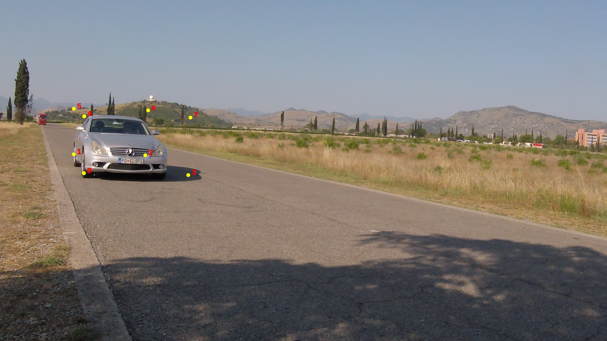
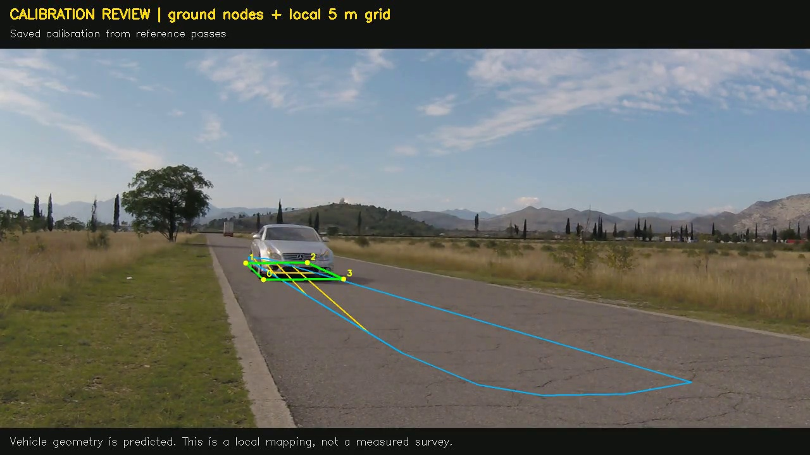
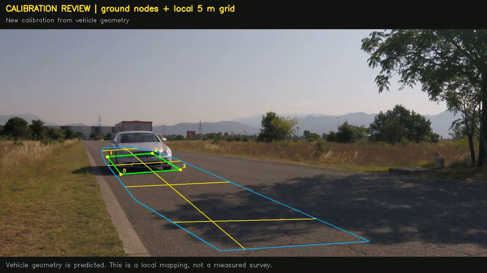

# Calibration investigation and remaining failures

The primary [30-clip report](../README.md) keeps one frozen predictor and all 27 held-out errors. This supplement records additional investigations. None of the alternatives below was promoted into that benchmark or used to replace its failure cases. No neural-network weights were trained or fine-tuned.

## Development sequence

1. The supplied folder contained 30 clips spanning 30–105 km/h. Reference values came from filenames, confirmed by the owner as constant cruise-control settings. Text annotation files were ignored. The videos have about 29.97 FPS and varying roadside views; camera views were checked at five sampled times within each clip. The [inventory](../clip_inventory.json) records those checks. Its strict visual groups are not a count of independently surveyed physical cameras.
2. The 30, 60 and 100 km/h clips were selected as pilots. The old production calibration requires at least three vehicle tracks, so these single-pass clips did not qualify. A diagnostic that relaxed this requirement produced 12.25, 11.97 and 19.73 km/h. These are explicitly diagnostic numbers, rather than accepted old production estimates.
3. Correcting longitudinal corner topology and the low-camera projective solver improved those pilots to 28.76, 42.71 and 81.96 km/h. Geometry alone still failed the requested tolerance.
4. Constant-speed pilot reference passes supplied a local metric road calibration. Its first pilot fit gave 30.00, 57.08 and 100.01 km/h. One shared metric-scale multiplier was then fitted to minimize the worst absolute pilot error, giving final pilot results near 30.56, 58.14 and 101.86 km/h. These are calibration-data fitting results.
5. The predictor and calibration were frozen for the remaining 27 clips. Ground-texture registration allowed reuse in 11 clips; 16 needed fresh automatic geometry estimates. Final held-out MAE was 9.41 km/h, with six clips within ±2 km/h. The two paths had MAE 3.82 and 13.25 km/h respectively.
6. The checks below investigated failures after the main predictor was fixed. In particular, the time-delay comparison revisits already evaluated cases and is exploratory. It is not a second independent accuracy result.

## Predicted corners and local road mapping

The numbered model corners in the 38 km/h case show a predicted corner extending beyond the visible car footprint into its shadow. This is qualitative evidence of unreliable geometry. There are no manually measured corner annotations here, so this image does not establish a numerical keypoint error. A projective solver can fit a mathematically plausible rectangle to an incorrect prediction and still infer an incorrect metric scale.

The 40 km/h case reuses the reference-assisted road map and estimates 39.2 km/h. The displayed 5 m grid is a local calibration hypothesis within supported ground locations.

The 78 km/h case needs new automatic calibration and estimates 47.2 km/h. The video and report retain that failure. A grid and a decimal label alone do not verify physical speed accuracy.

## Alternative constant-speed time-delay fit

A one-dimensional projective model was fitted jointly to predicted front and rear ground midpoints. Under constant motion, their passage time difference should equal assumed vehicle length divided by speed. The diagnostic used a 4.9 m length prior and a 80–300 pixel vehicle-height window.

On the 16 already evaluated automatic-fallback cases, mean absolute error changed from 13.25 to 7.49 km/h. The worst remaining case was 78 → 55.66 km/h, an error of 22.34 km/h. It also degraded the 98 km/h case from 97.11 to 81.92 km/h. The comparison was inspected after the original held-out results, so it cannot be claimed as fresh validation. It was not promoted. See [all diagnostic predictions](projective_delay_diagnostic.json). A synthetic test checks the estimator under known geometry; that test does not validate the learned vehicle corners.

## Lens-distortion sensitivity on pilots

Pilot predicted corners were undistorted using an assumed focal length of 550 pixels, principal point (960, 540), radial coefficient k1 in {-0.30, -0.15, 0, 0.15, 0.30, 0.50}, and k2 = 0. These are sensitivity settings, not measured camera intrinsics.

The best pilot-only automatic MAE in this sweep was 9.07 km/h at k1 = -0.15, compared with 12.19 km/h without this correction. Its 60 km/h estimate was still 40.55 km/h. The sweep therefore did not resolve the target error and no distortion setting was promoted. See [the complete sweep](lens_diagnostic.json).

## Other vehicle geometry models

The [UrbanOmniDetect-2 checkpoint](https://huggingface.co/mehmetkeremturkcan/UrbanOmniDetect-2) was tried on the same three pilots using 960-pixel inference and existing car tracks. Its corrected automatic estimates were approximately 24.95, 47.40 and 70.48 km/h, worse in aggregate than the original checkpoint's corrected pilot results. It was not promoted. [Pilot comparison](alternative_checkpoint_pilot.json) and [model revision, code revision and SHA-256](urbanomnidetect_v2_provenance.json) preserve this attempt. This was a local GPU diagnostic using Ultralytics 8.4.120; the primary Kaggle inference used pinned version 8.4.175.

The older [vehicle wheel-keypoint model](https://huggingface.co/kiselyovd/vehicle-keypoints), revision `27c593905dcc953cd46543be47548c4a9acaeaf4`, was also tried on pilot vehicle crops. With low detection confidence, it produced 51, 36 and 24 observations. Requiring both wheel points to have confidence at least 0.3 left nine usable pairs in the 30 km/h pilot and none in the other two. The remaining pilot time-profile fit had about 20.41 pixels RMS residual. This evidence was too sparse and unstable for calibration and the model was excluded.

Swapping the two ground-edge families was also checked on five failure cases. The checkpoint ordering was better in all five:

| Cruise reference km/h | Current corner order | Swapped edge order |
|---:|---:|---:|
| 33 | 24.11 | 10.73 |
| 38 | 17.75 | 8.86 |
| 62 | 79.06 | 34.56 |
| 78 | 47.22 | 24.86 |
| 90 | 61.22 | 41.48 |

## What the experiment establishes

Calibration and corner parsing substantially improved the initial diagnostic. Reference passes help where road correspondence is verified, but the 11 matching held-out clips still have 3.82 km/h mean error and only five within ±2 km/h. Unmatched views remain especially unreliable. One fitted multiplier cannot repair inconsistent hidden corners or perspective errors across changing views.

The current outputs do **not** establish the requested accuracy. A next calibration experiment needs independently confirmed vehicle dimensions or measured road distances, measured lens calibration for each setup, and reference passes covering unsupported views. A revised method selected using these inspected failures needs new independent test clips. The original CCTV camera requires its own calibration and independently measured speed references; the Mercedes mapping cannot supply them.

Cruise-control settings are useful references, but are not radar measurements and do not quantify their own reference uncertainty. The primary method's assumed 4.9 × 1.87 m vehicle dimensions have not been independently verified. No claim of ±1–2 km/h measurement accuracy is made.
