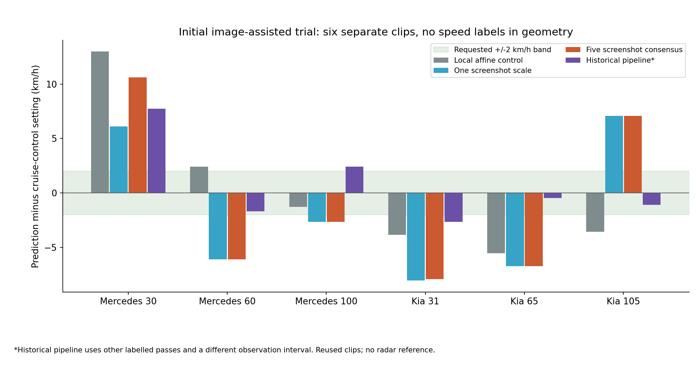
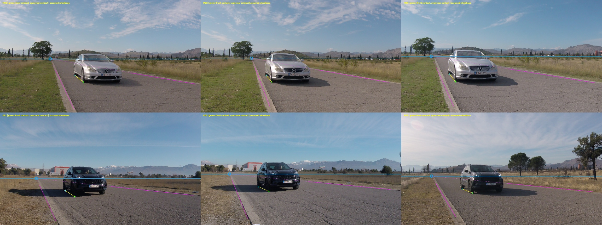
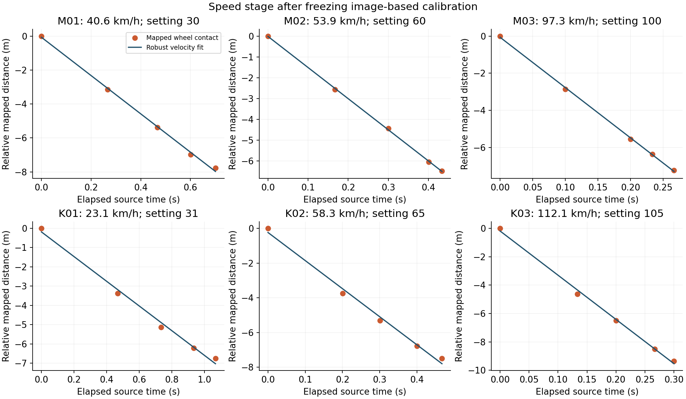

# Assistant image-assisted calibration: first six-clip trial

Date: 21 October 2026. **Not promoted to the main workflow:** the preselected five-screenshot consensus has **6.85 km/h MAE, 0/6 within +/-2 km/h, and a worst error of 10.61 km/h**. The historical pipeline has **2.68 km/h MAE on these same six clips**, with extra reference-speed assistance from other passes. The single-screenshot variant has 6.12 km/h MAE. These findings do not support the proposed improvement in this initial implementation.

The user authorized this assistant's image analysis for the first trial. No external GPT/Claude API was called, and no claim is made about any named external model. All six videos were previously studied; this is a development experiment, not fresh independent validation. The assistant had prior conversation context. Label-free images and an API that excludes reference speeds reduce leakage; they do not make this a double-blind study.

## Each clip is a separate test

All speeds below are km/h. Reference values are user-confirmed constant cruise-control settings read from filenames **only by the evaluation command**. The label text files are ignored. Reference uncertainty is unknown: no independent radar/GPS measurement or calibrated speedometer record was supplied.

| Clip | Interval (s) | Cruise setting | Screenshot consensus | Error | Historical pipeline* |
|---|---:|---:|---:|---:|---:|
| MercedesAMG550_30.MP4 | 3.570-4.271 | 30 | 40.6 | +10.6 | 37.7 |
| MercedesAMG550_60.MP4 | 4.137-4.571 | 60 | 53.9 | -6.1 | 58.3 |
| MercedesAMG550_100.MP4 | 4.171-4.438 | 100 | 97.3 | -2.7 | 102.4 |
| KiaSportage_31.MP4 | 2.870-3.937 | 31 | 23.1 | -7.9 | 28.3 |
| KiaSportage_65.MP4 | 4.037-4.505 | 65 | 58.3 | -6.7 | 64.5 |
| KiaSportage_105.MP4 | 3.871-4.171 | 105 | 112.1 | +7.1 | 103.9 |

*The historical values come from the existing Mercedes comparison and Kia validation CSVs. They use other known-speed passes and their original observation intervals. This is a comparison of available pipelines on the same constant-speed passages, not a controlled ablation of equal inputs.



## What the assistant actually did

1. Selected six initial clips spanning low, middle and high cruise settings, three per vehicle. Selected five source frames per clip by untruncated detection-box heights nearest 180, 230, 280, 330 and 380 pixels. The geometry stage receives anonymous IDs M01-M03 and K01-K03, not filenames or reference speeds.
2. Inspected full road images and pixel-grid crops. Marked visible near-side front/rear tyre ground contacts and two road-edge segments. Reviewed enlarged wheel crops and corrected marks visually before any numerical prediction/error scoring. The final observations are in each `annotations.json`. Hidden far-side wheel locations are not invented.
3. Used approximate wheelbase priors: 2.85 m for a visually inferred Mercedes CLS family, 2.67 m for a visually inferred Kia Sportage QL family. The exact Mercedes trim and Kia year remain unconfirmed. Wheelbase means axle separation, **not overall body length**. No vehicle was physically measured.
4. Froze three calibration variants per clip: a local affine control; projective mapping scaled by the middle screenshot; and the preselected median scale across five screenshots. The default consensus was chosen before errors, not switched to whichever version looked closest afterward.
5. Saved calibration JSONs, then mapped five front-wheel contacts with their source timestamps and fitted speed. No neural model retraining was involved. Eighteen separate predictions were saved and SHA-256 bound in `prediction_freeze.json` before the evaluation command read filename speed labels.
6. Perturbed wheel points (8 px standard deviation for Mercedes, 10 px for the shadowed Kia), road points (8 px) and wheelbase (+/-3.5%, uniform), with 2,000 deterministic Monte Carlo draws per prediction. Reported 2.5th/97.5th percentiles are **conditional sensitivity**, not validated confidence bounds. They exclude wrong road/vehicle assumptions, rolling-shutter/lens bias, camera movement and reference-speed error.

## Calibration and speed mathematics

Two marked longitudinal road edges give their image vanishing point. Assuming zero camera roll and a planar road, its vertical coordinate `h` supplies a horizontal road horizon. For a ground contact `(x,y)`, define `u = 1 / (y-h)`. For front/rear same-side wheel contacts, `k = wheelbase / abs(u_front-u_rear)`. Use one `k`, or the median of five `k` values, and freeze it. Relative along-path distance is `s = k * (u-u_initial)`. Speed is `3.6 * abs(ds/dt)` from a robust straight-line fit.

This is a restricted longitudinal metrology experiment. A single longitudinal vanishing point does not identify a full 2-D metric road homography, camera height, focal length, true pitch, or the full road length. The zero-roll/planarity/parallel-path assumptions supply information missing from the image. If the road curves or the chosen edges are not parallel, the calculation can be consistently biased. This follows projective metrology principles; it is not a reproduction of a published trained calibration network.

| Method | MAE (km/h) | Worst error | Within +/-2 |
|---|---:|---:|---:|
| local_affine | 4.94 | 12.98 | 1/6 |
| projective_single | 6.12 | 8.05 | 0/6 |
| projective_consensus | 6.85 | 10.61 | 0/6 |



## What the failure reveals

The problem is not confined to high speeds: the 30 km/h Mercedes produces the largest consensus error (40.6 km/h). The 100 km/h Mercedes is closer (97.3 km/h), while the 105 km/h Kia is overestimated (112.1 km/h). Several visible wheel separations are only a few tens of vertical pixels; small contact errors materially change the metre scale. Dark tyres merging with shadows and short source intervals make that worse. The projective correction also depends on which apparently parallel road edges the assistant marks.

The five-snapshot scale MAD can be small even when absolute speed is wrong: M01 passes internal consistency yet misses its cruise setting by 10.6 km/h. Multiple agreeing calibrations therefore do not establish correct metres. A language model can help propose points, vehicle hypotheses and regions, but this trial gives no evidence that its guessed road geometry replaces an independently measured scale reference.

Keep the existing multi-car CCTV calibration as the main workflow. Use assistant/manual observations as reviewable proposals; a measured road segment or confirmed vehicle wheelbase and precise ground contacts would supply stronger scale evidence. No empirical speed correction was tuned from these six labels, and the remaining clips were not added after this unsuccessful pilot. The earlier 25-clip Kia reserved study retains its historical meaning; the three Kia clips here are from its development subset.



## Files and reproduction

- `results.csv`: all 18 predictions, reference errors, intervals and sensitivity ranges.
- `metrics.json`: all methods and vehicle-specific summaries.
- `prediction_freeze.json`: hashes and pre-error method policy; `evaluation_sources.json`: filename mapping used only for preparation/evaluation.
- Each case folder: five raw frames, five annotated frames, pixel-grid sheet, `annotations.json`, `frames.json`, three calibration JSONs, three prediction JSONs and calibration review image.
- `model_smoke_check.json`: separate one-frame checkpoint smoke check. The screenshot trial itself uses assistant marks; it does not require detector weights at runtime.
- `verification.json`: checks and source/bundle validation recorded at handoff.

From the feature directory, reproduce a saved case without video/model downloads:

```powershell
python calibrate.py vision --annotations output/vision_assisted_trial/M01/annotations.json --method projective_consensus --output outputs/manual_M01/calibration.json
python estimate_speed.py vision --annotations output/vision_assisted_trial/M01/annotations.json --frames output/vision_assisted_trial/M01/frames.json --calibration outputs/manual_M01/calibration.json --output outputs/manual_M01/speed.json
python vision_trial.py evaluate
python -m unittest test_vision_calibration test_cctv
```

To rerun all numerical predictions, copy the six case input files/images to a **new experiment folder** before calling `vision_trial.py predict --folder <new folder>`. It refuses to overwrite a frozen experiment. `record_vision_annotations.py` records this assistant's fixed marks; rerunning it is not a fresh LLM inference. `prepare_vision_trial.py` re-extracts the original six cases when the private videos and saved detection tracks are available. No Kaggle job was launched for this trial; previous detector/geometry extraction used the documented Kaggle jobs. The numerical experiment runs locally from actual source frames and source timestamps.

## Research and model sources

- [Criminisi, Reid and Zisserman, Single View Metrology (2000)](https://ora.ox.ac.uk/objects/uuid%3A9b99df78-df75-49a9-a1b8-1b38e1b173a8): projective measurements require geometric constraints and scale information; this experiment uses a restricted 1-D form with extra assumptions.
- [Kia 2016 Sportage technical press kit](https://press.kia.com/ie/en/home/media-resouces/press-releases/2016/16_01_20_press-kit---kia-sportage-petd.html): 2.670 m wheelbase for that generation. The image-based generation identification remains a hypothesis.
- [Mercedes-Benz C219 archive](https://mercedes-benz-publicarchive.com/marsClassic/en/instance/ko/219-series-CLS-Coups-2004---2006.xhtml?oid=453318): vehicle-family appearance context; 2.85 m remains an approximate prior, not a confirmed measurement of this car.
- [Sochor et al. (2017)](https://arxiv.org/abs/1702.06451): full known-vehicle 3-D alignment differs from visually guessing a few wheel contacts.
- Actual project detector and cuboid weights are documented in [`model_manifest.json`](../../model_manifest.json). There is no separate `speed.pt` or `calibration.pt`.
